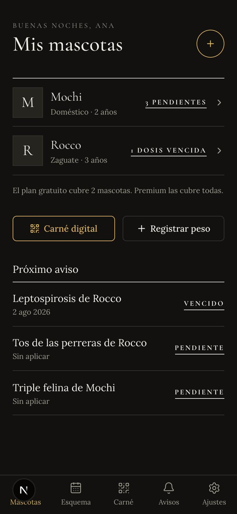
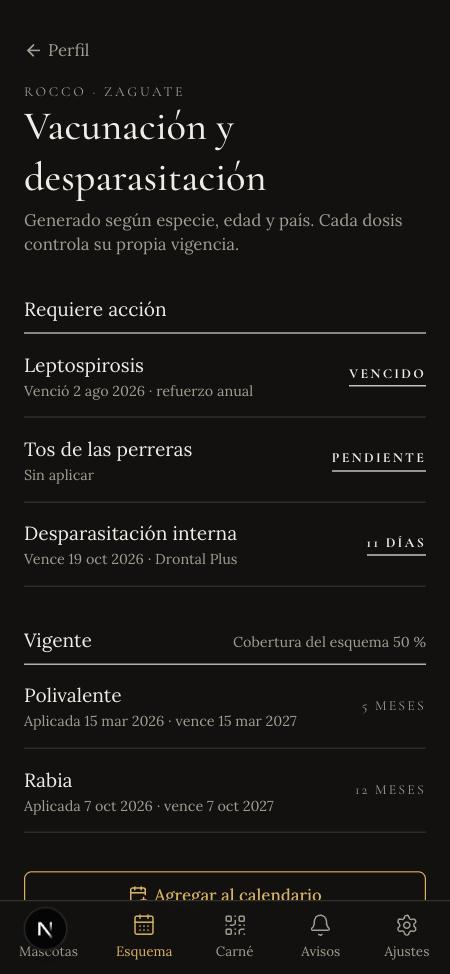
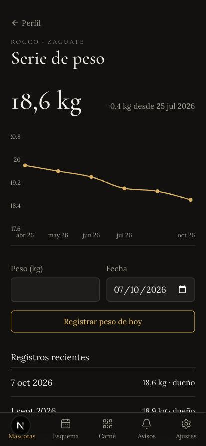
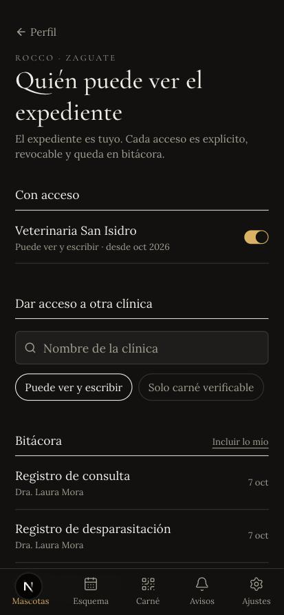
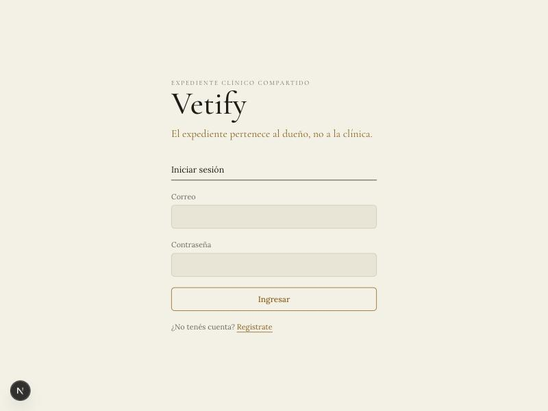
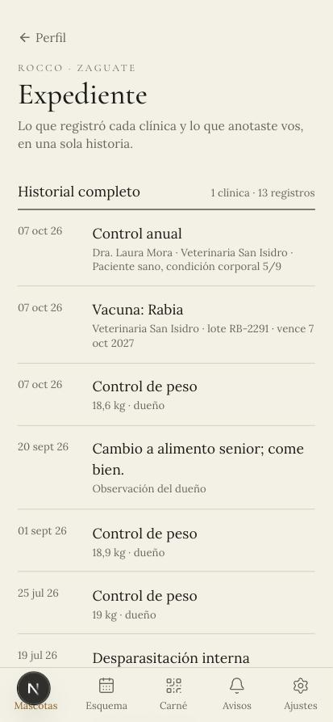
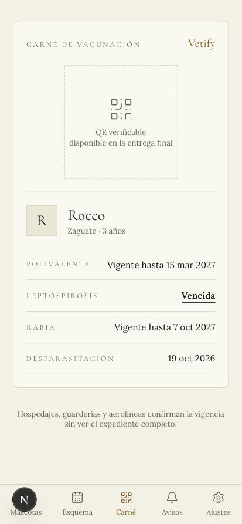
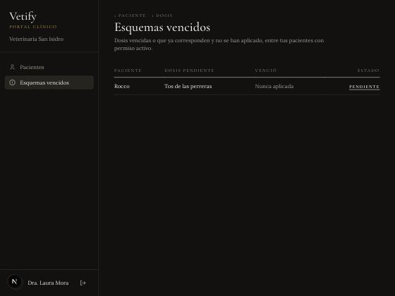

# Vetify — II Avance

**Curso:** EIF409 Aplicaciones Informáticas Globales · Universidad Nacional, Sede Regional Brunca
**Equipo:** Francisco Mora Cabezas · Alejandro León Marín
**Fecha de entrega:** 9 de octubre de 2026
**Repositorio:** monorepo `Vetify/` (rama `refactor/monorepo`)

---

## Contenido

1. [Propuesta a desarrollar](#1-propuesta-a-desarrollar)
2. [Estrategia de distribución](#2-estrategia-de-distribución)
3. [Esquema de generación de dinero](#3-esquema-de-generación-de-dinero)
4. [Situaciones presentadas en el desarrollo](#4-situaciones-presentadas-en-el-desarrollo)
5. [Avance de desarrollo](#5-avance-de-desarrollo)
6. [Próximos pasos hacia la entrega final](#6-próximos-pasos-hacia-la-entrega-final)

---

## 1. Propuesta a desarrollar

### 1.1 Problema

En Costa Rica, el historial médico de una mascota vive en el sistema de la clínica que la
atiende. Cuando el dueño cambia de veterinario, se muda, viaja o lleva al animal a una
emergencia fuera de horario, ese historial no lo acompaña: se pierden vacunas aplicadas,
diagnósticos previos y tratamientos. El resultado son vacunas duplicadas o atrasadas,
diagnósticos que arrancan de cero y un carné de vacunas en papel que se moja, se pierde y no
se puede verificar.

El problema de fondo no es técnico sino de **propiedad del dato**: los sistemas actuales
pertenecen a la clínica y encierran la información.

### 1.2 Solución

**Vetify** es una aplicación móvil y web (PWA) de **expediente clínico compartido para
mascotas**. Invierte la propiedad del dato:

- El expediente **pertenece al dueño**, es único, portátil y acompaña al animal toda su vida.
- Lo alimentan dos partes: el **dueño** registra el día a día (peso, alimentación,
  observaciones) y la **clínica** registra el acto médico (consultas, vacunas,
  desparasitaciones, tratamientos y exámenes).
- El dueño decide, con **consentimiento revocable en un toque**, qué clínicas pueden ver y
  escribir en el expediente. Cada acceso queda en una **bitácora** que el dueño puede revisar.
- Un **carné digital con QR verificable** permite que hospedajes, guarderías y aerolíneas
  confirmen la vigencia de vacunas sin ver el resto del expediente.

### 1.3 Usuarios

| Actor                          | Qué hace en Vetify                                                                          |
| ------------------------------ | ------------------------------------------------------------------------------------------- |
| Dueño de mascota               | Posee el expediente, registra el día a día, comparte y revoca acceso, recibe recordatorios. |
| Clínica / personal veterinario | Registra el acto médico de los pacientes cuyo dueño le dio acceso.                          |
| Verificador (tercero)          | Escanea el QR del carné y ve solo la vigencia de vacunas.                                   |

### 1.4 Cumplimiento de los elementos exigidos por el curso

| Elemento exigido                      | Cómo lo cumple Vetify                                                                                                                                                                 | Estado                |
| ------------------------------------- | ------------------------------------------------------------------------------------------------------------------------------------------------------------------------------------- | --------------------- |
| **Registro / captura de información** | Registro de mascotas, consultas, vacunas, desparasitaciones, tratamientos, exámenes, peso y alimentación, por dos tipos de usuario.                                                   | Implementado          |
| **Proceso**                           | Cálculo del esquema de vacunación por país, especie y edad: vencimientos, vacunas pendientes, cobertura y generación de recordatorios. Control de acceso por consentimiento.          | Implementado          |
| **Salidas**                           | Expediente consolidado, esquema con cobertura, bitácora de accesos, carné con vigencias, gráfica de peso y exportación de avisos a calendario (ICS). Pendiente: QR verificable y PDF. | Parcial               |
| **Análisis de datos**                 | Serie de peso con tendencia (hecho) y lista de esquemas vencidos por clínica (hecho). Pendiente: rango esperado por raza, frecuencia y motivo de consultas.                           | Parcial               |
| **Carácter innovador**                | El expediente es del dueño, no de la clínica, con consentimiento revocable y bitácora de accesos. No existe una solución así en el mercado local.                                     | Implementado (núcleo) |
| **Componente de IA**                  | Detección de anomalías de peso, clasificación del motivo de consulta y resumen previo a la consulta para el veterinario.                                                              | Final                 |

### 1.5 Módulos funcionales

1. **Cuenta y sesión:** registro como dueño o clínica, inicio y cierre de sesión.
2. **Mis mascotas:** alta y edición del perfil del animal.
3. **Expediente:** acto médico (clínica) y día a día (dueño), consolidado en una sola vista.
4. **Consentimiento:** otorgar acceso completo o solo al carné, revocar y consultar la bitácora.
5. **Esquema de vacunación y recordatorios:** reglas por país, especie y edad.
6. **Carné digital QR** con verificación pública.
7. **Analítica e IA:** curva de peso, anomalías, resumen previo a la consulta.
8. **Portal web de la clínica:** pacientes con permiso activo y registro del acto médico.

### 1.6 Arquitectura y herramientas (resumen)

El detalle está en [`ARQUITECTURA.md`](./ARQUITECTURA.md); el modelo de datos, en
[`MODELO_DATOS.md`](./MODELO_DATOS.md).

| Capa     | Tecnología                                                                                      |
| -------- | ----------------------------------------------------------------------------------------------- |
| Monorepo | Turborepo + pnpm. Contratos compartidos en `packages/types` (Zod).                              |
| Frontend | Next.js 16 + React 19, Tailwind 4, shadcn/ui, TanStack Query. PWA con Serwist. Hosting: Vercel. |
| API      | NestJS 12 (ESM), JWT con Passport y argon2, Swagger. Contenedor Docker en Render.               |
| Datos    | PostgreSQL (Neon en producción, Docker en desarrollo) con Prisma 7.                             |
| Calidad  | Vitest, ESLint/oxlint, Prettier, Husky, GitHub Actions (lint, typecheck, test, build y deploy). |

**Decisión de diseño central:** toda la autorización vive en el API. Una clínica accede a una
mascota **solo** si existe un permiso activo del dueño, y esa verificación ocurre en un único
punto del servidor (`PermisosService.autorizar`). Ocultar un botón en la interfaz no es
autorizar.

---

## 2. Estrategia de distribución

### 2.1 Distribución del producto

**Vetify se distribuye como Progressive Web App (PWA)**, no como app de tienda, por cuatro
razones:

1. **Una sola base de código** para Android, iOS y escritorio: con un equipo de dos personas,
   mantener tres clientes no es viable.
2. **Sin comisión de tiendas** (15 % a 30 % sobre suscripciones digitales) y sin esperar
   revisiones para publicar una corrección.
3. **Instalación sin fricción:** el dueño escanea un QR en la recepción de la clínica, abre el
   enlace y la agrega a la pantalla de inicio. No hay que buscarla en una tienda ni descargar
   decenas de megas.
4. **Funciona sin conexión:** el expediente ya consultado se sigue viendo sin señal, algo
   importante en zonas rurales de la Región Brunca.

Si en una fase posterior se necesita presencia en Google Play, la PWA se empaqueta como
**Trusted Web Activity** sin reescribir nada. El monorepo deja reservada `apps/mobile` para una
app nativa con Expo que reutilizaría los mismos contratos y hooks.

### 2.2 Infraestructura de distribución

| Componente | Servicio                     | Por qué                                                                  |
| ---------- | ---------------------------- | ------------------------------------------------------------------------ |
| Web / PWA  | Vercel (CDN global en edge)  | Carga rápida desde cualquier país, despliegue automático por cada merge. |
| API        | Render (Docker)              | Contenedor portable: se puede mover de proveedor sin tocar código.       |
| Base       | Neon (PostgreSQL gestionado) | Respaldos automáticos, ramas de base para pruebas, escala por demanda.   |
| CI/CD      | GitHub Actions               | Nada llega a producción sin pasar lint, typecheck, pruebas y build.      |

### 2.3 Estrategia de salida al mercado

El modelo es **B2B2C liderado por la clínica**: la clínica es el canal que trae a los dueños,
y el dueño es quien lleva Vetify a la siguiente clínica.

| Fase                    | Alcance                                                               | Meta                                                             |
| ----------------------- | --------------------------------------------------------------------- | ---------------------------------------------------------------- |
| **1. Piloto** (6 meses) | Región Brunca, con foco en Pérez Zeledón: 5 a 10 clínicas aliadas.    | 1.000 mascotas registradas, 70 % con al menos un permiso activo. |
| **2. Nacional**         | Resto de Costa Rica, priorizando cabeceras de provincia.              | 100 clínicas pagando.                                            |
| **3. Regional**         | Centroamérica. El modelo ya guarda el esquema de vacunación por país. | Primer país adicional.                                           |

### 2.4 Canales

- **Clínicas como canal de captación.** Material de recepción con un QR de registro y un
  onboarding de un minuto durante la consulta. La clínica gana: recibe pacientes con historia
  completa y sin costo de migración.
- **Invitación del dueño a su clínica.** Cuando un dueño quiere compartir con una clínica que
  aún no está en Vetify, la invita. Cada dueño activo es un vendedor de la plataforma.
- **El carné QR como bucle viral.** Hospedajes, guarderías y aerolíneas que verifican carnés
  conocen la plataforma y la recomiendan a los dueños que todavía usan carné en papel.
- **Colegio de Médicos Veterinarios y gremios:** charlas y educación continua sobre
  expediente digital y consentimiento.
- **Campañas públicas:** jornadas de vacunación antirrábica y castración de municipalidades y
  ONG, donde se registra al animal en el momento.
- **Redes sociales y contenido** de tenencia responsable, y **boca a boca** entre dueños.

### 2.5 Indicadores

Clínicas activas, mascotas registradas, porcentaje de expedientes compartidos con al menos una
clínica, retención de dueños a 30 días, conversión a Premium y verificaciones de carné por mes.

---

## 3. Esquema de generación de dinero

### 3.1 Modelo

Modelo **freemium para el dueño y suscripción para la clínica**, con dos fuentes
complementarias. Es coherente con el Business Model Canvas del I Avance.

| Fuente                         | Quién paga                         | Precio                                                                             |
| ------------------------------ | ---------------------------------- | ---------------------------------------------------------------------------------- |
| **Plan gratuito**              | —                                  | ₡0 · hasta 2 mascotas. Es el motor de adopción.                                    |
| **Premium (dueño)**            | Dueño                              | ₡1.500 al mes · mascotas ilimitadas, respaldo, alertas avanzadas, exportación PDF. |
| **Suscripción de clínica**     | Clínica                            | ₡15.000 a ₡45.000 al mes, escalonado (ver 3.2).                                    |
| **Verificación para terceros** | Hospedajes, guarderías, aerolíneas | Por volumen de verificaciones de carné.                                            |
| **Comisión de referidos**      | Farmacias y aseguradoras           | 5 % a 10 % por conversión.                                                         |

**El dueño nunca paga por ser dueño de su expediente.** El plan gratuito incluye todo lo
esencial (expediente, consentimiento, carné QR y recordatorios básicos); Premium cobra por
comodidad y volumen, no por acceso a sus propios datos.

### 3.2 Planes para clínicas

| Plan            | Precio mensual | Incluye                                                                                             |
| --------------- | -------------- | --------------------------------------------------------------------------------------------------- |
| **Piloto**      | ₡0 (3 meses)   | Para las primeras 10 clínicas de la fase 1. Ya modelado: `clinicas.plan` vale `piloto` por defecto. |
| **Consultorio** | ₡15.000        | 1 veterinario, portal de pacientes, registro del acto médico.                                       |
| **Clínica**     | ₡30.000        | Hasta 4 veterinarios, recordatorios a pacientes, reportes de adherencia y retorno.                  |
| **Cadena**      | ₡45.000        | 5 o más veterinarios o varias sedes, analítica y resumen previo con IA.                             |

### 3.3 Proyección ilustrativa al cierre del piloto (mes 12)

> Supuestos del equipo, para dimensionar el modelo. Se validan durante el piloto.

| Fuente       | Supuesto                                         | Ingreso mensual |
| ------------ | ------------------------------------------------ | --------------: |
| Clínicas     | 15 clínicas, precio promedio ₡25.000             |        ₡375.000 |
| Premium      | 3.000 dueños activos, 5 % de conversión          |        ₡225.000 |
| Verificación | 5 aliados, ₡10.000 por paquete de verificaciones |         ₡50.000 |
| Referidos    | Conversiones esporádicas                         |         ₡30.000 |
| **Total**    |                                                  |    **₡680.000** |

**Costos de operación.** Durante el desarrollo y el inicio del piloto se usan capas gratuitas
(Vercel, Render y Neon). Para operar comercialmente hay que pasar a planes pagos (por ejemplo,
Vercel Pro, una instancia de Render sin suspensión y Neon con más almacenamiento), del orden de
US$50 al mes, además del dominio. El costo de infraestructura crece con el uso, pero lento: el
grueso del gasto es desarrollo, soporte y adquisición de clínicas.

### 3.4 Por qué el modelo se sostiene

- **Quien recibe más valor operativo paga.** La clínica ahorra tiempo de admisión, reduce
  vacunas duplicadas y mejora el retorno de pacientes con recordatorios.
- **El dueño es gratis para que la red crezca.** Cada dueño que comparte su expediente le
  muestra Vetify a una clínica nueva.
- **Ingresos diversificados.** Si una fuente tarda en madurar, las otras sostienen la operación.
- **Los datos no se venden.** Las comisiones por referidos se basan en una conversión que el
  dueño decide; nunca se comparte el expediente con terceros sin consentimiento.

---

## 4. Situaciones presentadas en el desarrollo

Cada situación con su impacto, cómo se resolvió y qué se aprendió.

### 4.1 Supabase en el cliente chocaba con la propiedad del expediente

- **Situación.** La primera versión hablaba con Supabase desde el navegador y dependía de
  políticas RLS para la autorización.
- **Impacto.** La regla central del producto (una clínica accede solo con permiso activo y
  todo acceso queda en bitácora) quedaba repartida entre políticas SQL y la interfaz. Era
  difícil de probar y de auditar.
- **Resolución.** Se migró a un monorepo con un API propio en NestJS. El frontend ya no toca la
  base: todo pasa por `api-client.ts`, y la autorización vive en un único servicio con pruebas
  unitarias, incluido el caso denegado (`403`).
- **Lección.** La regla de negocio más importante tiene que vivir en un solo lugar del
  servidor, y ese lugar tiene que estar probado.

### 4.2 `next-pwa` no funciona con Next.js 16

- **Situación.** `next-pwa` inyecta configuración de webpack; Next 16 compila con Turbopack por
  defecto.
- **Resolución.** Se reemplazó por **Serwist en _configurator mode_**: el service worker se
  compila como paso aparte (`serwist build`) a partir de `src/sw.ts`.
- **Lección.** Revisar que las dependencias sigan el ritmo del framework antes de adoptarlas.

### 4.3 El `latest` de Prisma era un release candidate con otra CLI

- **Situación.** Al instalar Prisma, npm entregaba un _release candidate_ de la versión 8, sin
  `migrate dev` ni `generate`. Además, en Prisma 7 la URL de conexión ya no va en
  `schema.prisma`.
- **Resolución.** Prisma quedó **fijado en 7.10.0**. La URL se movió a `prisma.config.ts` y el
  cliente se conecta con el adaptador de `pg`.
- **Lección.** Fijar versiones de las piezas críticas y no confiar en `latest`.

### 4.4 Identificadores en español con "ñ"

- **Situación.** El rol `dueño` y la columna `dueño_id` son correctos en la base y en la
  interfaz, pero Prisma no admite "ñ" en sus identificadores.
- **Resolución.** El cliente de Prisma usa `dueno` y `@map` conserva `dueño` en la base. Un
  único módulo (`common/mapeo.ts`) traduce entre ambos mundos.

### 4.5 `npm install` falla en el monorepo

- **Situación.** Al clonar el repositorio, `npm i` falla con
  `Unsupported URL Type "workspace:"`.
- **Causa.** El monorepo usa **pnpm**; el protocolo `workspace:*` que enlaza los paquetes
  internos no existe en npm.
- **Resolución.** Instalar con pnpm, que se activa con Corepack (`corepack pnpm install`), y
  documentarlo en el README.

### 4.6 pnpm bloqueaba scripts de instalación necesarios

- **Situación.** pnpm 10 no ejecuta scripts de instalación salvo los permitidos. Quedaban
  bloqueados `@prisma/engines` (descarga el motor que necesita `prisma migrate`) y `esbuild`
  (lo usa Vitest).
- **Resolución.** Se agregaron a `onlyBuiltDependencies` en `pnpm-workspace.yaml`. El de
  telemetría (`@scarf/scarf`) quedó bloqueado a propósito.

### 4.7 La base en Neon no estaba lista

- **Situación.** El esquema de Prisma estaba validado, pero no había una base para aplicar las
  migraciones.
- **Resolución.** Se desarrolló contra **PostgreSQL local en Docker** (`docker compose up -d db`).
  Pasar a Neon es solo cambiar `DATABASE_URL`, porque las migraciones son las mismas.

### 4.8 Detectar el robo de sesiones

- **Situación.** Un refresh token robado permitiría mantener una sesión abierta
  indefinidamente.
- **Resolución.** El refresh token se **rota** en cada uso y se guarda solo su hash. Si llega
  un token de una sesión ya rotada, alguien lo reutilizó, así que se cierran **todas** las
  sesiones del usuario. Dos refrescos simultáneos no pueden ganar los dos: la revocación es
  condicional.

### 4.9 Fechas sin hora y zonas horarias

- **Situación.** Las fechas de aplicación y vencimiento son columnas `date`. Al convertirlas en
  JavaScript con la zona horaria local, una vacuna aplicada el 10 de enero podía mostrarse como
  el 9.
- **Resolución.** Las fechas sin hora se manejan siempre como `AAAA-MM-DD` a medianoche UTC,
  tanto en el API como en la interfaz.

### 4.10 Nombres de vacunas escritos de distintas formas

- **Situación.** Para calcular la vigencia hay que cruzar la vacuna aplicada con el esquema del
  país, pero "Rabia", "rabia " o "Antirrábica" no coinciden como texto.
- **Resolución.** Se normaliza el nombre (sin tildes, sin espacios, en minúsculas). Además, el
  portal de la clínica ofrece las vacunas del esquema en una lista, y el API guarda el nombre
  oficial del catálogo.

### 4.11 Mensajes de validación en inglés

- **Situación.** Zod responde por defecto en inglés ("Invalid input: expected string…").
- **Resolución.** Se configuró el idioma español una sola vez en `@vetify/types`. Como el API y
  la web validan con los mismos esquemas, ambos muestran los mismos mensajes, como "Este campo
  es obligatorio".

### 4.12 "Hoy" no es el mismo día en UTC

- **Situación.** Después de las 6 p. m. en Costa Rica, la fecha en UTC ya es el día siguiente.
  El API y la interfaz calculaban "hoy" en UTC, así que una vacuna que vencía en un año
  aparecía a "12 meses", y el peso registrado de noche quedaba con la fecha de mañana.
- **Resolución.** El API calcula hoy en la zona `America/Costa_Rica` y la interfaz usa la
  fecha local del dispositivo. Los registros sin fecha toman la de Costa Rica, no la de la base.
- **Lección.** En una app de fechas sin hora, "hoy" es una decisión de negocio, no
  `new Date()`.

### 4.13 El tema oscuro no se aplicaba

- **Situación.** Con el sistema en modo oscuro, la app seguía en claro aunque el `<html>` tenía
  la clase `dark`.
- **Causa.** Los colores del tema oscuro estaban dentro de `@layer base`, y en CSS una regla
  sin capa (`:root`) le gana a cualquier regla en capa, sin importar el orden.
- **Resolución.** Los tokens del tema oscuro se definen fuera de las capas.

---

## 5. Avance de desarrollo

### 5.1 Resumen

Están funcionando, de punta a punta (base de datos → API → interfaz), los tres bloques
comprometidos para este avance: **autenticación**, **expediente** y **esquema de
vacunación**, junto con el **consentimiento** que los hace posibles.

| Requerimiento                                           | Estado                                                                                      |
| ------------------------------------------------------- | ------------------------------------------------------------------------------------------- |
| RF-01 Registro como dueño o clínica                     | ✅ Hecho                                                                                    |
| RF-02 Inicio de sesión y sesión persistente             | ✅ Hecho                                                                                    |
| RF-03 Cierre de sesión e invalidación del refresh token | ✅ Hecho                                                                                    |
| RF-04 Registrar mascota                                 | ✅ Hecho (la foto queda para la final)                                                      |
| RF-05 Consultar y editar mascotas                       | ✅ Consultar en la interfaz; editar en el API                                               |
| RF-06 Acto médico por la clínica con permiso            | ✅ Consultas, vacunas y desparasitaciones en la interfaz; tratamientos y exámenes en el API |
| RF-07 Peso y alimentación por el dueño                  | ✅ Hecho                                                                                    |
| RF-08 Expediente consolidado                            | ✅ Hecho                                                                                    |
| RF-09 Otorgar permiso (completo o solo carné)           | ✅ Hecho                                                                                    |
| RF-10 Revocar permiso con corte inmediato               | ✅ Hecho                                                                                    |
| RF-11 Bitácora de accesos                               | ✅ Hecho                                                                                    |
| RF-16 Esquema de vacunación por país, especie y edad    | ✅ Hecho (catálogo de Costa Rica para perro y gato)                                         |
| RF-17 Vigencias y recordatorios                         | 🟡 Avisos calculados para dueño y clínica; falta el envío por push                          |
| RF-15 Exportar recordatorios a calendario (ICS)         | ✅ Hecho desde Esquema y Avisos                                                             |
| RF-18 Curva de peso                                     | 🟡 Serie y tendencia; falta el rango esperado por raza                                      |
| RF-12, RF-13 Carné QR y verificación                    | 🟡 Carné con vigencias reales; falta el QR firmado                                          |
| RF-14 PDF                                               | ⏳ Final                                                                                    |
| RF-19, RF-20 IA                                         | ⏳ Final                                                                                    |

### 5.2 Base de datos

- **Dos migraciones aplicadas:** `inicial` (las 16 entidades del modelo más
  `sesiones_refresco`) y `esquemas_vacunacion_cr` (catálogo de vacunas de Costa Rica).
- **Catálogo de Costa Rica:** perro (Polivalente, Leptospirosis, Rabia, Tos de las perreras) y
  gato (Triple felina, Leucemia felina, Rabia), con edad mínima y vigencia de 12 meses.

### 5.3 API

Documentado con Swagger en `http://localhost:3001/api/docs`.

| Método | Ruta                                                                                  | Quién                       | Qué hace                                                  |
| ------ | ------------------------------------------------------------------------------------- | --------------------------- | --------------------------------------------------------- |
| POST   | `/auth/registrar`                                                                     | Público                     | Crea dueño, o clínica y su responsable                    |
| POST   | `/auth/iniciar-sesion`                                                                | Público                     | Devuelve access y refresh token                           |
| POST   | `/auth/refrescar`                                                                     | Público                     | Rota el refresh token                                     |
| POST   | `/auth/cerrar-sesion`                                                                 | Autenticado                 | Revoca la sesión del dispositivo                          |
| GET    | `/auth/yo`                                                                            | Autenticado                 | Usuario actual                                            |
| GET    | `/mascotas`                                                                           | Dueño / clínica             | Mascotas propias o pacientes con permiso activo           |
| POST   | `/mascotas`                                                                           | Dueño                       | Registra una mascota                                      |
| GET    | `/mascotas/:id`                                                                       | Dueño / clínica con permiso | Perfil                                                    |
| PATCH  | `/mascotas/:id`                                                                       | Dueño                       | Edita el perfil                                           |
| GET    | `/mascotas/:id/expediente`                                                            | Dueño / clínica con permiso | Expediente consolidado                                    |
| GET    | `/mascotas/:id/vacunacion`                                                            | Dueño / clínica con permiso | Estado del esquema y cobertura                            |
| POST   | `/mascotas/:id/consultas`, `vacunas`, `desparasitaciones`, `tratamientos`, `examenes` | Clínica con permiso         | Acto médico                                               |
| POST   | `/mascotas/:id/peso`, `alimentacion`                                                  | Dueño                       | Día a día                                                 |
| GET    | `/mascotas/:id/permisos`                                                              | Dueño                       | Clínicas con acceso                                       |
| POST   | `/mascotas/:id/permisos`                                                              | Dueño                       | Otorga acceso                                             |
| PATCH  | `/mascotas/:id/permisos/:permisoId/revocar`                                           | Dueño                       | Revoca acceso                                             |
| GET    | `/mascotas/:id/bitacora`                                                              | Dueño                       | Bitácora de accesos                                       |
| GET    | `/avisos`                                                                             | Dueño / clínica             | Dosis atrasadas y próximas de todas las mascotas visibles |
| GET    | `/clinicas?busqueda=`                                                                 | Autenticado                 | Directorio de clínicas                                    |
| GET    | `/clinicas/mia`                                                                       | Clínica                     | Clínica del usuario                                       |

**Seguridad implementada**

- Contraseñas con **argon2**. Un correo inexistente tarda lo mismo que una contraseña
  incorrecta, para no revelar qué correos están registrados.
- **JWT de acceso corto (15 min)** y **refresh token rotado**, con detección de reutilización.
- **Límite de tasa** estricto en registro, inicio de sesión y refresco (10 por minuto).
- **Autorización en un único punto** (`PermisosService.autorizar`), con cuatro operaciones:
  `leer`, `acto_medico`, `dia_a_dia` y `administrar`.
  - A un dueño que no es el dueño de la mascota se le responde `404`, no `403`, para no
    revelar que existe.
  - Revocar corta el acceso **en la siguiente petición**, porque los permisos no se cachean.
- **Bitácora automática:** un interceptor global registra todo acceso exitoso a una ruta con
  `:mascotaId`. No depende de que alguien se acuerde de escribirla.

### 5.4 Interfaz

Pantallas reales en Next.js que siguen el **diseño final** del I Avance
([`diseno/diseno-pwa-vetify.pdf`](./diseno/diseno-pwa-vetify.pdf)). Las reglas de ese diseño se
aplicaron tal cual:

- **Una sola aplicación:** barra de pestañas en el teléfono (Mascotas, Esquema, Carné, Avisos,
  Ajustes), barra lateral en escritorio, y portal clínico con barra lateral.
- **Estados sin color:** "Vencido", "Pendiente", "12 días" se distinguen por palabra, filete y
  peso tipográfico.
- **El acento se reserva:** el dorado solo marca lo accionable.
- **Claro y oscuro:** papel o negro cálido. Por defecto sigue al sistema y se puede fijar en
  Ajustes.

Todas las pantallas tienen estados de carga, error y vacío.

| Pantalla                                    | Ruta                                      |
| ------------------------------------------- | ----------------------------------------- |
| Ingreso y registro                          | `/iniciar-sesion`, `/registro`            |
| Mis mascotas, con estado y próximo aviso    | `/mascotas`, `/mascotas/nueva`            |
| Perfil de la mascota                        | `/mascotas/[id]`                          |
| Historial completo y observaciones          | `/mascotas/[id]/expediente`               |
| Vacunación y desparasitación (+ calendario) | `/mascotas/[id]/vacunas`, pestaña Esquema |
| Serie de peso con gráfica                   | `/mascotas/[id]/peso`                     |
| Carné de vacunación                         | `/mascotas/[id]/carne`, pestaña Carné     |
| Quién puede ver el expediente y bitácora    | `/mascotas/[id]/permisos`                 |
| Avisos y Ajustes (tema, cuenta)             | `/avisos`, `/ajustes`                     |
| Portal: pacientes y expediente compartido   | `/pacientes`, `/pacientes/[id]`           |
| Portal: esquemas vencidos (adherencia)      | `/vencidos`                               |

**Capturas** (en `docs/diseno/capturas/`):

| Mis mascotas                                                  | Vacunación y desparasitación                        | Serie de peso                                       | Quién puede ver el expediente                         |
| ------------------------------------------------------------- | --------------------------------------------------- | --------------------------------------------------- | ----------------------------------------------------- |
|  |  |  |  |

| Ingreso (claro)                                    | Historial completo (claro)                               | Carné (claro)                                  |
| -------------------------------------------------- | -------------------------------------------------------- | ---------------------------------------------- |
|  |  |  |

| Portal: expediente compartido                         | Portal: esquemas vencidos                             |
| ----------------------------------------------------- | ----------------------------------------------------- |
|  |  |

### 5.5 Pruebas y verificación

- **Pruebas unitarias (Vitest), 17 en verde:**
  - Autorización: el dueño lee y registra el día a día; otro dueño recibe `404`; el dueño no
    puede registrar acto médico; **una clínica sin permiso activo recibe `403`**; solo cuentan
    los permisos activos, de alcance completo y de una clínica del usuario; una clínica con
    permiso no puede tocar el día a día ni administrar.
  - Esquema de vacunación: clasificación en vigente, por vencer, vencida, pendiente y "aún no
    aplica"; uso de la última aplicación; vencimiento explícito de la clínica; cachorros sin la
    edad mínima; suma de meses en fin de mes; última desparasitación por tipo; orden de los
    avisos (lo atrasado primero).
  - Validación del entorno del API.
- **Prueba de punta a punta contra la base real:** registrar dueño y clínica → la clínica
  recibe `403` → el dueño otorga acceso → la clínica registra vacuna y consulta → el dueño
  registra peso → el dueño ve el expediente y la cobertura → el dueño revoca → la clínica
  vuelve a recibir `403` → la bitácora muestra cada paso → la reutilización de un refresh
  token cierra todas las sesiones.
- **Recorrido en el navegador** del mismo flujo desde la interfaz, en móvil y escritorio.
- `pnpm turbo run lint typecheck test build` en verde en todo el monorepo.

### 5.6 Cómo correr la demostración

```bash
corepack pnpm install
docker compose up -d db
cp apps/api/.env.example apps/api/.env   # DATABASE_URL local y secretos JWT
corepack pnpm --filter @vetify/api exec prisma migrate dev
corepack pnpm dev                          # web en :3000, API en :3001
```

---

## 6. Próximos pasos hacia la entrega final

1. **Carné digital QR** con token firmado por el API y ruta pública `/verificar/[token]`, que
   muestra solo la vigencia de vacunas.
2. **Notificaciones push (VAPID)** de los recordatorios que ya se generan, y exportación ICS.
3. **Analítica:** curva de peso contra el rango esperado (Recharts), frecuencia y motivo de
   consultas, adherencia a la vacunación.
4. **IA:** detección de anomalías de peso, clasificación del motivo de consulta y resumen
   previo a la consulta.
5. Exportación del expediente a **PDF**, foto de la mascota y edición del perfil en la interfaz.
6. Pantallas del mockup que faltan: agenda del día y resumen previo con IA en el portal.
7. Despliegue en **Neon + Render + Vercel**, manuales técnico y de usuario, y defensa.
