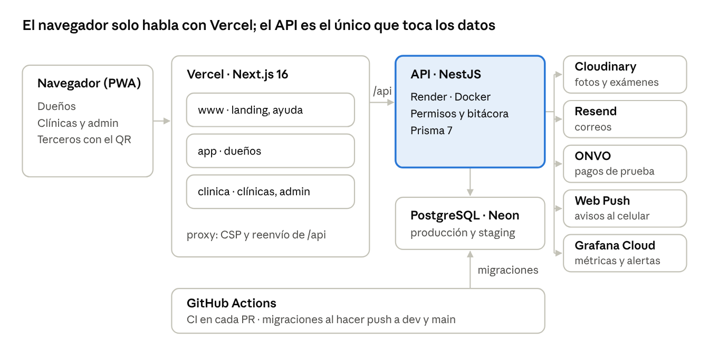
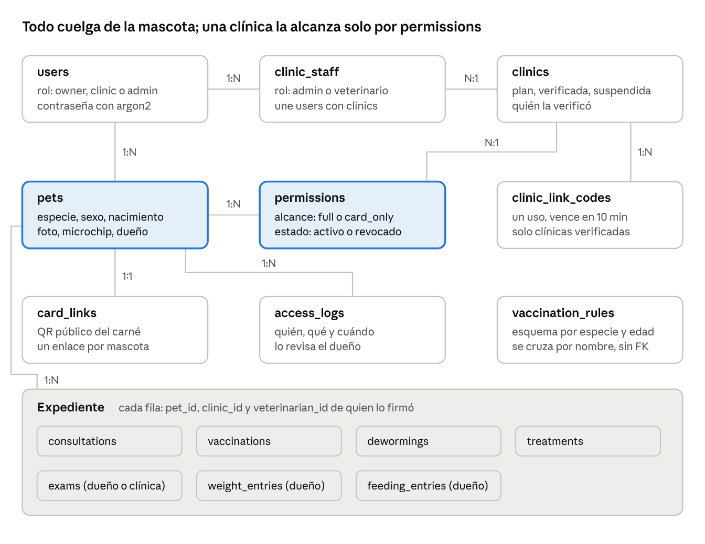

# Vetify — Documento del proyecto

12 de noviembre de 2026 · Francisco Mora Cabezas · Alejandro León Marín

## Resumen

Vetify es un expediente clínico compartido de mascotas que pertenece al dueño, no a la clínica, y
está publicado en producción desde el 12 de noviembre de 2026 en
[vetify.live](https://www.vetify.live).

En Costa Rica el historial de una mascota queda en el sistema de cada clínica. Cuando el dueño
cambia de veterinario, viaja o llega a una emergencia, ese historial no lo acompaña: se pierden
vacunas, diagnósticos y tratamientos, y el carné en papel no se puede verificar.

Vetify invierte la propiedad del dato. El dueño lleva un único expediente para toda la vida del
animal y decide, con un permiso que revoca en un toque, qué clínicas lo ven y escriben en él. Cada
acceso queda en una bitácora que el dueño puede revisar.

- **Curso:** EIF409 Aplicaciones Informáticas Globales · Universidad Nacional, Sede Regional Brunca.
- **Equipo:** Francisco Mora Cabezas · Alejandro León Marín.
- **Producto:** aplicación web progresiva (PWA) en tres sitios: `www` (landing y manuales), `app`
  (dueños) y `clinica` (clínicas y administración).
- **Carácter académico:** los pagos funcionan solo en modo de prueba de ONVO; no se cobra dinero real.

## Propuesta desarrollada

La propuesta del II Avance se implementó completa en sus módulos centrales; el componente de IA
quedó en reglas (alertas de peso) y no en un modelo.

### Usuarios y lo que hace cada uno

| Actor                    | Sitio                       | Qué hace en Vetify                                                                                                           |
| ------------------------ | --------------------------- | ---------------------------------------------------------------------------------------------------------------------------- |
| Dueño                    | `app.vetify.live`           | Registra mascotas, carga exámenes externos, peso y observaciones; comparte y revoca acceso; recibe avisos; muestra el carné. |
| Administrador de clínica | `clinica.vetify.live`       | Se registra con el enlace de Vetify, invita al equipo, genera códigos de vinculación, maneja el plan y atiende pacientes.    |
| Veterinario              | `clinica.vetify.live`       | Registra consultas, vacunas, desparasitaciones, tratamientos y exámenes firmados con su nombre.                              |
| Administrador de Vetify  | `clinica.vetify.live/admin` | Genera enlaces de alta, verifica, suspende y reactiva clínicas. Nunca ve mascotas.                                           |
| Tercero verificador      | Enlace del QR               | Hospedajes, guarderías o aerolíneas ven solo la vigencia de vacunas.                                                         |

### Cumplimiento de los elementos del curso

| Elemento                | Cómo lo cumple Vetify                                                                                                                                                            |
| ----------------------- | -------------------------------------------------------------------------------------------------------------------------------------------------------------------------------- |
| Registro de información | Mascotas, consultas, vacunas, desparasitaciones, tratamientos, exámenes con archivo, peso y observaciones, cargados por dueños y clínicas.                                       |
| Proceso                 | Esquema de vacunación de Costa Rica por especie y edad, vencimientos, alertas de peso (cambio de 10 % o más en 90 días), permisos por consentimiento y verificación de clínicas. |
| Salidas                 | Expediente consolidado, carné con QR verificable, PDF del expediente y del carné, avisos push y por correo, exportación a calendario (ICS), bitácora de accesos.                 |
| Análisis de datos       | Serie de peso con tendencia y alertas, esquemas vencidos por clínica, cobertura del esquema.                                                                                     |
| Carácter innovador      | El expediente es del dueño, con consentimiento revocable, bitácora y actos firmados por veterinario.                                                                             |

### Modelo de negocio

Freemium para el dueño y suscripción para la clínica: quien recibe más valor operativo paga, y el
dueño nunca paga por ser dueño de su expediente.

| Plan        | Quién   | Precio mensual | Incluye                                                      |
| ----------- | ------- | -------------- | ------------------------------------------------------------ |
| Gratuito    | Dueño   | ₡0             | Expediente, carné QR, recordatorios, hasta 2 mascotas        |
| Premium     | Dueño   | ₡1.500         | Mascotas ilimitadas, exportación en PDF                      |
| Piloto      | Clínica | ₡0 por 3 meses | Para las primeras 10 clínicas                                |
| Consultorio | Clínica | ₡15.000        | 1 veterinario, portal de pacientes, acto médico              |
| Clínica     | Clínica | ₡30.000        | Hasta 4 veterinarios, recordatorios y reportes de adherencia |
| Cadena      | Clínica | ₡45.000        | 5 o más veterinarios o varias sedes                          |

Los pagos de dueños pasan por ONVO Checkout en modo de prueba. El alta de una clínica se acuerda
fuera de la app: el administrador de Vetify confirma el pago y le envía el enlace de registro.

### Distribución

Vetify se distribuye como PWA: una sola base de código para Android, iOS y escritorio, sin comisión
de tiendas y con instalación desde un enlace o un QR. La salida al mercado es B2B2C: la clínica
trae a los dueños y cada dueño lleva Vetify a la siguiente clínica.

## Arquitectura y tecnología

Vetify es un monorepo Turborepo con una web Next.js que sirve los tres sitios y un API NestJS que
concentra toda la lógica y la autorización; el navegador nunca habla directo con la base.

El navegador llama a `/api` en su mismo sitio y Vercel lo reenvía al API, así las cookies quedan en
el mismo origen. La única excepción son las subidas a Cloudinary, que el navegador hace directo con
una firma que entrega el API.

| Capa           | Tecnología                                                                   |
| -------------- | ---------------------------------------------------------------------------- |
| Monorepo       | Turborepo y pnpm; contratos compartidos en `packages/types` con Zod          |
| Web            | Next.js 16, React 19, Tailwind 4, shadcn/ui, TanStack Query; PWA con Serwist |
| API            | NestJS (ESM), JWT con refresh en cookie HttpOnly, argon2, Swagger y OpenAPI  |
| Datos          | PostgreSQL con Prisma 7; Neon en la nube, Docker en desarrollo               |
| Observabilidad | OpenTelemetry hacia Grafana Cloud                                            |
| Calidad        | Vitest, oxlint y ESLint, Prettier, Husky, GitHub Actions, SonarCloud         |

## Modelo de datos

La base es PostgreSQL con 29 tablas definidas en Prisma (`apps/api/prisma/schema.prisma`); la
mascota es el centro y una clínica solo llega a ella a través de un permiso activo del dueño.

Las tablas resaltadas son las de la regla central: `pets` pertenece a un usuario dueño, y
`permissions` une una mascota con una clínica con un alcance (`full` o `card_only`) y un estado.
Las tablas del expediente guardan quién firmó cada acto; el peso y las observaciones los carga solo
el dueño.

| Grupo                     | Tablas                                                                                                    | Para qué                                                                                  |
| ------------------------- | --------------------------------------------------------------------------------------------------------- | ----------------------------------------------------------------------------------------- |
| Cuentas y sesiones        | `users`, `refresh_sessions`, `password_resets`                                                            | Dueños, clínicas y admins; sesiones con refresh rotado; recuperación de contraseña        |
| Clínicas                  | `clinics`, `clinic_staff`, `clinic_invitations`, `clinic_signup_links`, `clinic_suspensions`              | Equipo y roles, invitaciones, alta con enlace del admin, auditoría de suspensiones        |
| Mascotas y consentimiento | `pets`, `permissions`, `clinic_link_codes`, `access_logs`, `card_links`                                   | El expediente es del dueño; permisos revocables, códigos de un uso, bitácora y QR público |
| Expediente                | `consultations`, `vaccinations`, `dewormings`, `treatments`, `exams`, `weight_entries`, `feeding_entries` | Actos médicos firmados y registros del día a día                                          |
| Reglas y análisis         | `vaccination_rules`, `anomalies`, `reminders`                                                             | Esquema de vacunación de Costa Rica; alertas de peso; recordatorios                       |
| Avisos                    | `app_notifications`, `email_deliveries`, `push_subscriptions`, `push_deliveries`                          | Bandeja de avisos del dueño y su entrega por correo y push, con reintentos                |
| Pagos y archivos          | `payments`; columnas de archivo en `pets` y `exams`                                                       | Pagos de ONVO en modo de prueba; archivos firmados en Cloudinary                          |
| Infraestructura           | `idempotency_results`                                                                                     | Respuesta guardada por clave, para que un reintento no duplique                           |

### Reglas que impone el modelo

- Borrar una mascota o una cuenta borra en cascada su expediente, permisos, bitácora y archivos.
- Un permiso se revoca cambiando su estado; la fila se conserva y puede restablecerse.
- Una clínica suspendida conserva sus permisos, pero no cuentan hasta que se reactive.
- Los códigos de vinculación y los enlaces de alta se guardan solo como hash.
- Las fechas clínicas (aplicación, vencimiento, examen) son fechas sin hora; los eventos (consulta,
  bitácora) son marcas de tiempo.

## Seguridad y privacidad

Toda la autorización vive en el API: una clínica accede a una mascota solo si el dueño le dio un
permiso activo, y esa regla se comprueba en un único punto (`PermissionsService.authorize`).
Ocultar un botón en la interfaz no cuenta como autorizar.

| Control                         | Cómo funciona                                                                                                                                                    |
| ------------------------------- | ---------------------------------------------------------------------------------------------------------------------------------------------------------------- |
| Consentimiento del dueño        | Permiso completo o solo carné, otorgado con un código de un solo uso que dura 10 minutos y que solo una clínica verificada puede generar. Se revoca al instante. |
| Bitácora                        | Cada lectura o escritura de una clínica queda registrada con quién, qué y cuándo; el dueño la ve en la app.                                                      |
| Actos firmados                  | Cada consulta, vacuna o examen guarda el veterinario y la clínica que lo registraron, tomados de la sesión y no de lo que envía el cliente.                      |
| Alta y verificación de clínicas | Solo con enlace del administrador; la clínica empieza sin verificar y se registra quién la verifica.                                                             |
| Suspensión de emergencia        | Corta al instante el acceso y las sesiones de todo el equipo; queda auditada con motivo.                                                                         |
| Sesiones                        | Contraseñas con argon2, token de acceso corto y refresh rotado en cookie HttpOnly; reusar un refresh viejo revoca todas las sesiones.                            |
| Web                             | CSP con nonce por request, verificación de origen, límites de intentos, el service worker nunca guarda datos del API.                                            |
| Archivos                        | Subidas firmadas por el API para una sola mascota, tipo y tamaño limitados; los exámenes se abren con un enlace que dura 5 minutos.                              |
| Escrituras repetidas            | Claves de idempotencia: un reintento no duplica un registro.                                                                                                     |
| Cierre de cuenta                | El dueño borra su cuenta con sus mascotas, expediente, permisos, archivos y pagos.                                                                               |

El detalle de cada control y su evidencia está en `docs/SECURITY_HANDOFF.md`.

## Calidad y validación

Ningún cambio llega a `dev` ni a producción sin pasar lint, chequeo de tipos, pruebas y build en
GitHub Actions, y la versión publicada se recorrió completa en staging antes del release.

| Capa                    | Qué se prueba                                                                                                      | Estado al 12 nov 2026   |
| ----------------------- | ------------------------------------------------------------------------------------------------------------------ | ----------------------- |
| API, unitarias (Vitest) | Servicios, autorización, esquema de vacunas, correos, pagos                                                        | 169 pasan               |
| API, E2E adversarial    | El API real contra una base PostgreSQL desechable: escalada de permisos, roles, sesiones, idempotencia, suspensión | 68 pasan, 0 fallan      |
| Web (Vitest)            | Ruteo entre sitios, fechas, etiquetas, PDF, subidas                                                                | 48 pasan                |
| Integración continua    | Lint, typecheck, pruebas y build en cada PR; SonarCloud; puntaje de PR                                             | Verde en el release #57 |

### Flujo de trabajo

- Cada tarea va en su propia rama y PR hacia `dev`, que publica en staging (`*.stg.vetify.live`).
- `main` solo acepta PR desde `dev` y publica en producción.
- Las migraciones de la base se aplican automáticamente al hacer push a cada rama, antes de que el
  API nuevo arranque.

### Validación funcional en staging

El 11 y 12 de noviembre se recorrió Vetify completo con correos reales del equipo: un dueño con
exámenes PDF, un consultorio, una clínica con tres veterinarios, verificación, vinculación y actos
firmados. Se encontraron 12 problemas y se corrigieron en los PR #51 a #56 antes de publicar. El
detalle está en `docs/VALIDACION_STAGING.md`, y los manuales de uso salieron de ese recorrido:
[para dueños](https://www.vetify.live/ayuda/duenos) y
[para clínicas](https://www.vetify.live/ayuda/clinicas).

## Operación, despliegue y costos

Vetify opera con capas gratuitas de todos sus servicios; el único gasto fijo es el dominio
`vetify.live`, US$54,99 al año, que renueva el 7 de noviembre de 2027.

| Servicio                   | Uso                                                                     | Plan                                                              |
| -------------------------- | ----------------------------------------------------------------------- | ----------------------------------------------------------------- |
| Vercel                     | Web y PWA, los tres sitios, preview por PR                              | Gratuito                                                          |
| Render                     | API en Docker (`vetify-api` y `vetify-api-stg`)                         | Gratuito: se duerme sin uso y la primera petición tarda unos 50 s |
| Neon                       | PostgreSQL de producción y de staging (rama `dev`)                      | Gratuito                                                          |
| Cloudinary                 | Fotos y archivos de exámenes, entrega autenticada                       | Gratuito                                                          |
| Resend                     | Correos desde `noreply@vetify.live`                                     | Gratuito                                                          |
| Zoho Mail                  | Buzón `admin@` y alias `contacto@`                                      | Gratuito                                                          |
| ONVO                       | Pagos en modo de prueba                                                 | Sin costo                                                         |
| Grafana Cloud              | Métricas, logs, alertas y chequeo horario que mantiene despierto el API | Prueba hasta el 21 nov 2026, luego gratuito                       |
| GitHub Actions, SonarCloud | CI, migraciones y análisis de código                                    | Gratuito                                                          |

### Monitoreo

Grafana recibe métricas y logs de producción y avisa por correo ante errores 5xx por encima del 5 %
durante 10 minutos, latencia p95 por encima de 2 s, errores en los logs o el API caído. Cada
respuesta del API trae un `X-Request-Id` para seguir un error de punta a punta.

### Operar con clientes reales

Pasar de proyecto académico a producto requiere planes pagos del orden de US$50 al mes (una
instancia de Render que no se duerma, Vercel Pro y más almacenamiento en Neon), claves live de ONVO
y revisión legal de los términos.
