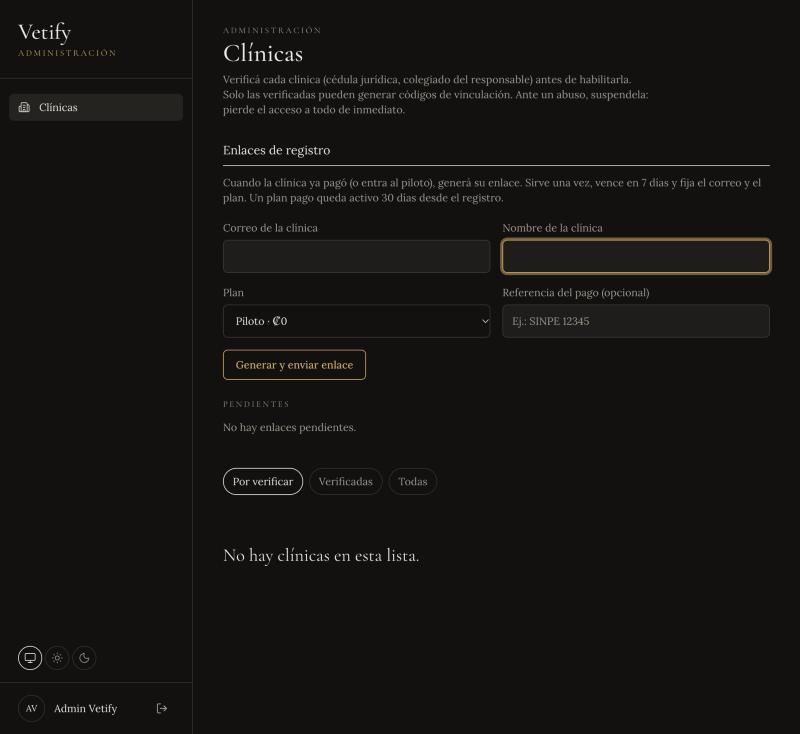
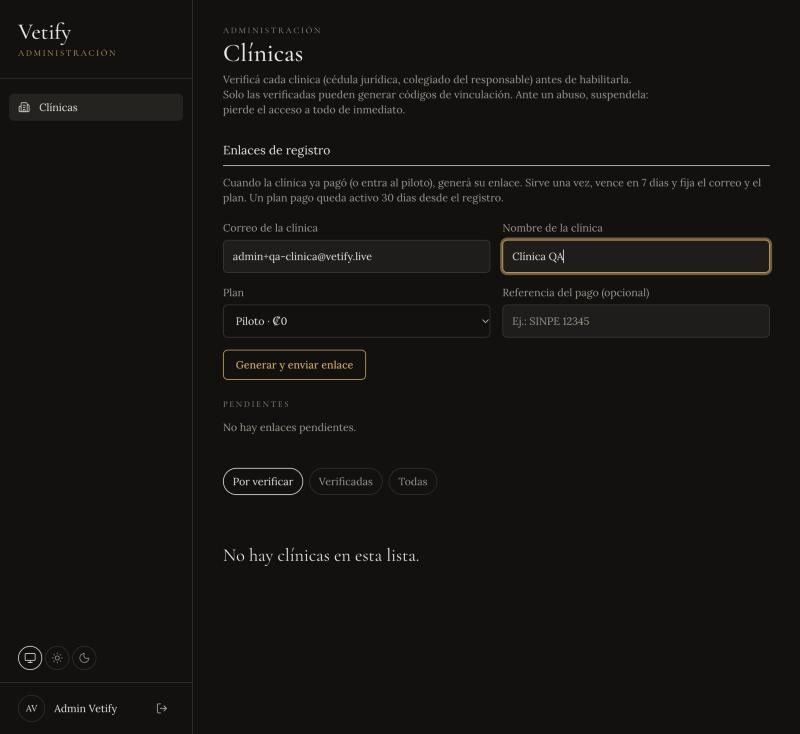
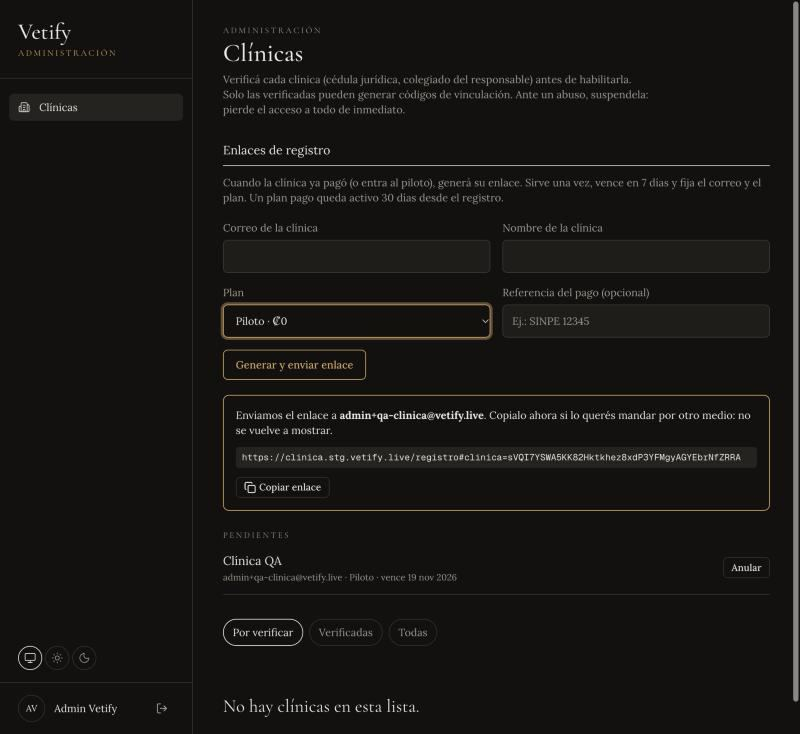
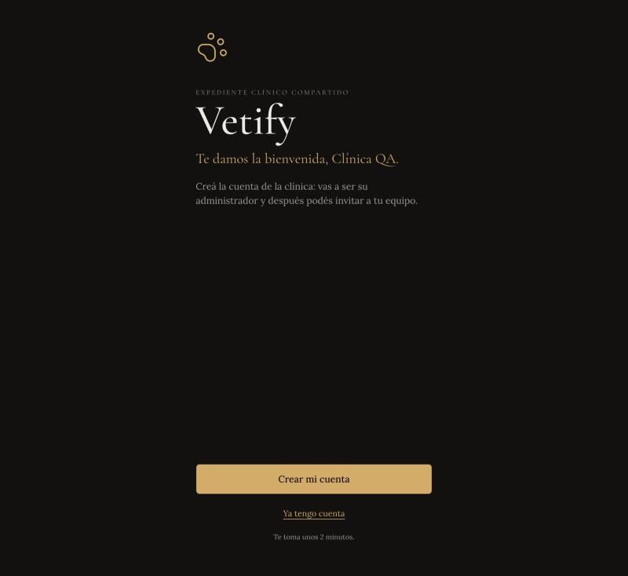
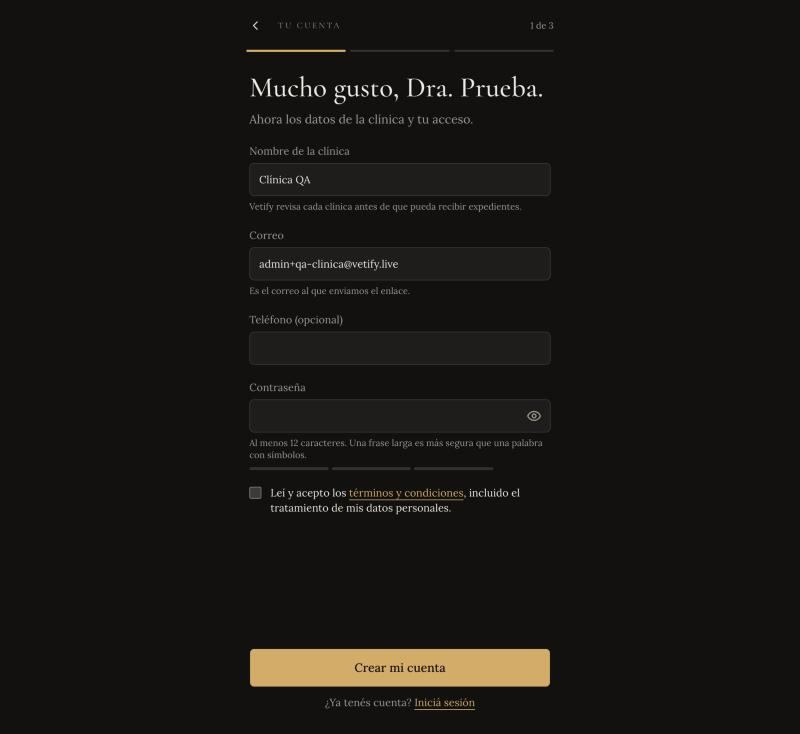
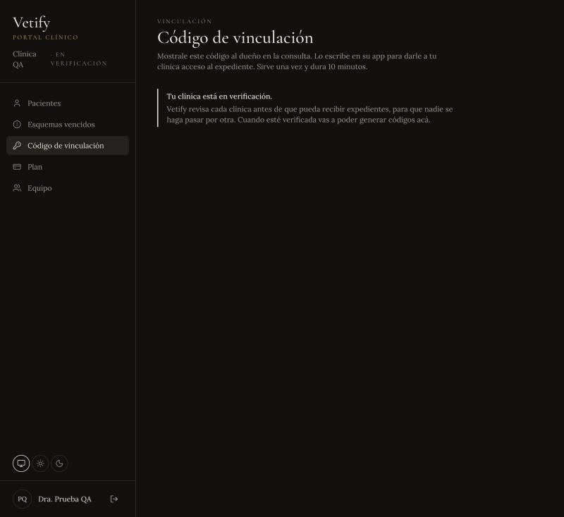
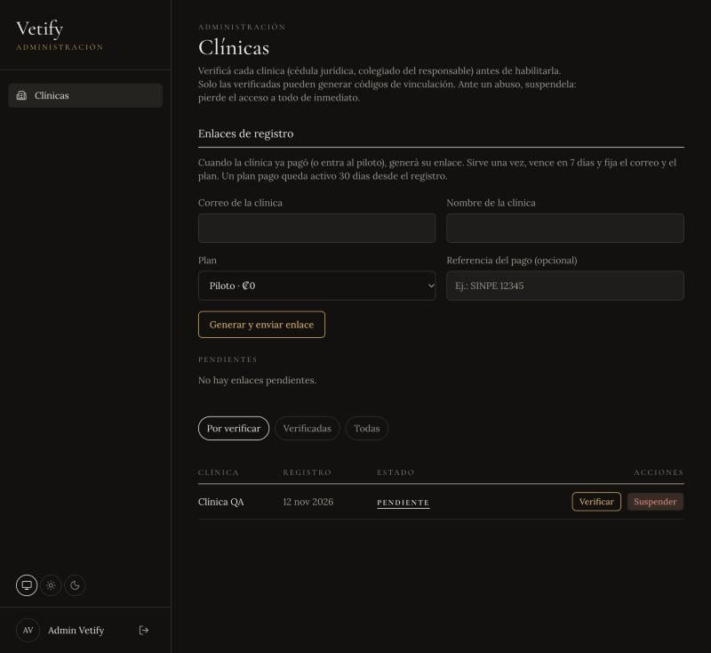
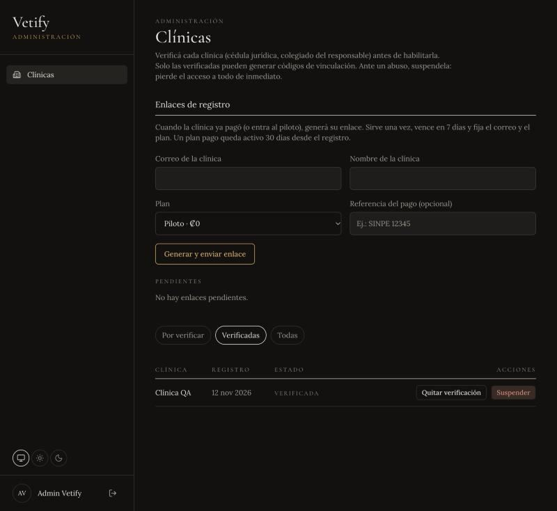

# Guía de verificación de clínicas

Procedimiento interno del administrador de Vetify. Una clínica nueva puede entrar a su portal
enseguida, pero no recibe expedientes hasta que un administrador confirma que es real. Las
capturas son de staging, con la clínica de prueba "Clínica QA" (11 de noviembre de 2026).

Los manuales públicos para dueños y clínicas están en la landing, en `/ayuda`
(`apps/web/src/components/landing/help-guides.tsx`).

## Antes de empezar

- Hace falta una cuenta con `users.role = admin`. No se registra desde la app: se crea con
  `pnpm --filter @vetify/api admin:create` (variables `DATABASE_URL`, `ADMIN_EMAIL`, `ADMIN_NAME`,
  `ADMIN_PASSWORD`). Si el correo ya tiene cuenta, el script la convierte en admin y le cierra las
  sesiones.
- El panel está en `clinica.vetify.live/admin/clinicas`.

## 1. Generar el enlace de registro (admin)

Cuando la clínica ya pagó o entra al piloto, escribí su correo y su nombre, elegí el plan y, si
hubo pago, la referencia. **Generar y enviar enlace** manda el correo y muestra el enlace una sola
vez. Sirve una vez, vence en 7 días y se puede anular mientras esté pendiente.

## 2. La clínica se registra (clínica)

Abre el enlace, completa el nombre del responsable, la contraseña y los términos. El correo viene
fijo. Queda como administradora de la clínica, que arranca **en revisión**: puede entrar, ver su
plan e invitar al equipo, pero no generar códigos de vinculación. A cada admin de Vetify le llega
"Clínica por verificar: …".

## 3. Revisar fuera de la app (admin)

La app no guarda documentos; solo registra el resultado. Antes de verificar:

- **Cédula jurídica** de la clínica, a nombre de quien acordó el pago o el piloto.
- **Responsable colegiado**: inscrito y activo en el Colegio de Médicos Veterinarios de Costa Rica.
- Que el **correo** y el **nombre** registrados coincidan con lo acordado.

## 4. Verificar (admin)

En **Por verificar** tocá **Verificar** y confirmá. La clínica pasa a **Verificadas** con la fecha y
el nombre del admin, y a sus administradores les llega "… ya está verificada en Vetify". Desde ese
momento genera códigos de vinculación.

## Después

- **Quitar verificación**: deja de generar códigos nuevos. Los permisos que los dueños ya dieron
  siguen activos hasta que ellos los quiten.
- **Suspender**: ante un abuso. Corta al instante el acceso a todos los expedientes y cierra las
  sesiones del equipo. Pide un motivo y queda registrado quién suspendió y quién reactivó.
