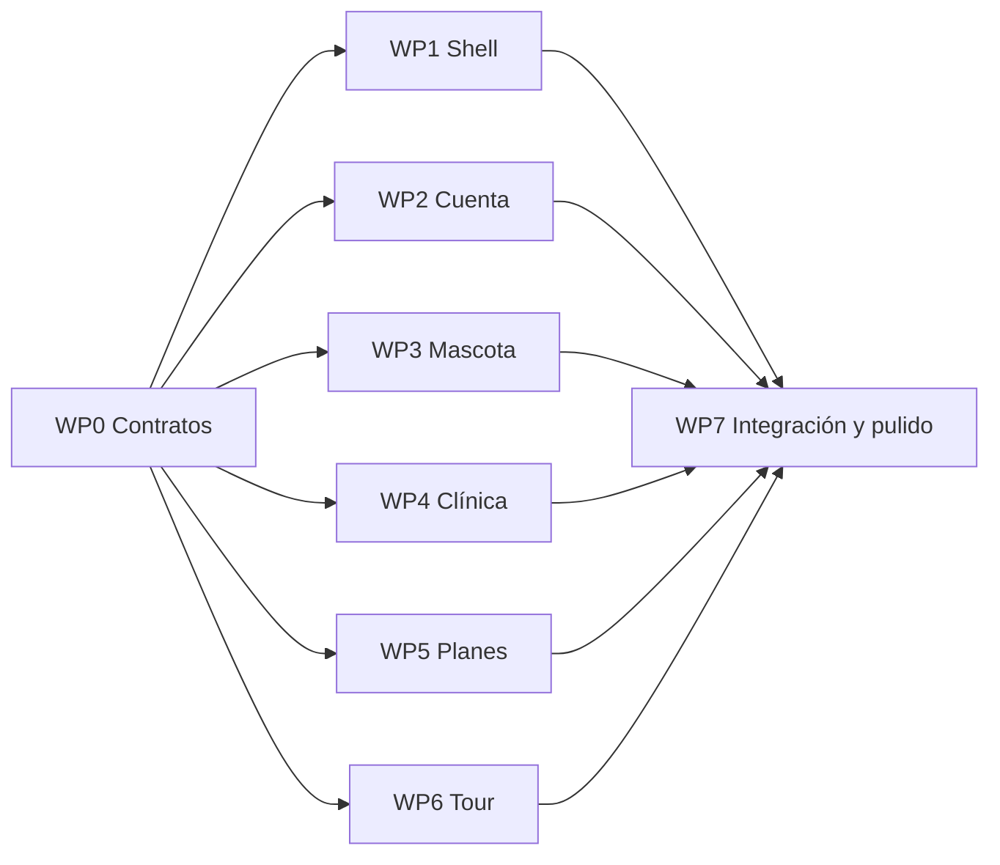

# Plan: registro interactivo, planes y tour guiado

Última actualización: 21 de octubre de 2026. Estado: **implementado** (rama `refactor/refactor-plan`).
Ver "Implementación" al final para lo que cambió respecto de este plan.
Prototipo navegable: [diseno/onboarding/prototipo.html](diseno/onboarding/prototipo.html)
(se abre directo en el navegador; ver [su README](diseno/onboarding/README.md)). También está en el
canvas [Vetify · Onboarding](https://claude.ai/artifact/AEZ8BErq7BQCiN6LYRSkSK) (privado).
**Es la referencia visual obligatoria** de textos, orden de pasos y comportamiento.

## Objetivo

Vetify se vende como una aplicación premium. La primera impresión tiene que sentirse cuidada,
personal e interactiva. El registro actual es un solo formulario
(`apps/web/src/components/auth/register-form.tsx`) que crea la cuenta y deja al usuario en una
pantalla vacía. Lo reemplazamos por:

1. **Un asistente paso a paso**, animado y con barra de progreso: cuenta → primera mascota
   ("creando el expediente") → planes.
2. **Una pantalla de planes** (gratuito y pago, con sus condiciones) antes de entrar a la app.
3. **Un tour guiado** la primera vez que el usuario llega a su inicio, con opción de saltarlo y de
   repetirlo desde Ajustes.

### Fuera de alcance

- **Cobro real** (pasarela, suscripciones, webhooks, límite de mascotas aplicado en el servidor).
  Es un proyecto aparte y requiere revisión de seguridad. Aquí la pantalla de planes es
  informativa.
- Cambios en la API, en Prisma o en `@vetify/types`. Este plan usa solo endpoints existentes.
- Tour para el panel de administración.

## Decisiones tomadas

| Decisión                                                                        | Motivo                                                                                                                                                                                                |
| ------------------------------------------------------------------------------- | ----------------------------------------------------------------------------------------------------------------------------------------------------------------------------------------------------- |
| La cuenta se crea al terminar el paso **Acceso** (`POST /auth/register` actual) | Los pasos siguientes usan endpoints autenticados que ya existen (`useCreatePet`, idempotente). Así no se guarda la contraseña en memoria durante todo el asistente y no hace falta un endpoint nuevo. |
| Todo el asistente vive en **un componente cliente** en `/registro`              | El estado se comparte entre pasos sin rutas intermedias. Si el usuario recarga después de crear la cuenta, ya tiene sesión y va a su inicio (la pantalla vacía ya lo guía).                           |
| Animaciones con **`motion`** (`motion/react`)                                   | Transiciones entre pasos (`AnimatePresence`), barra de progreso y lista de "creando expediente". `MotionConfig reducedMotion="user"` respeta la preferencia de reducir el movimiento.                 |
| Tour con **`driver.js`**                                                        | ~5 KB, MIT, sin dependencias de framework; resalta el elemento, muestra el globo, botones Saltar, Atrás y Siguiente, y el avance. Se estiliza con nuestros tokens.                                    |
| El tour se muestra **solo después del registro**                                | El usuario pidió el tour "únicamente cuando inicia desde cero". El asistente deja una marca en `localStorage`; el tour la consume. Un usuario existente en un dispositivo nuevo no lo ve.             |
| Los planes se definen **una sola vez** en `src/lib/plans.ts`                    | Hoy `FREE_PLAN_LIMIT` está en `my-pets.tsx` y "Gratuito" está fijo en `settings.tsx`. Pasan a importar de ahí.                                                                                        |
| **Premium sin cobro todavía**                                                   | Al elegir Premium se muestra "El pago se habilita pronto; mientras tanto empezás con Gratuito" y el usuario continúa. No se guarda la elección en el servidor.                                        |

**CSP:** `style-src 'unsafe-inline'` ya está permitido en `src/proxy.ts`, así que los estilos en
línea de `motion` y los `<style>` de `driver.js` funcionan sin cambios. No se carga nada externo.

## Flujos

Pasos por rol. La barra de progreso tiene **3 secciones**; cada una se llena según el paso dentro
de ella.

| #   | Dueño                                                                                                      | Clínica                                                 | Sección                 |
| --- | ---------------------------------------------------------------------------------------------------------- | ------------------------------------------------------- | ----------------------- |
| 0   | `welcome`: bienvenida, "Crear mi cuenta", "Ya tengo cuenta"                                                | igual                                                   | (sin barra)             |
| 1   | `role`: "¿Cómo vas a usar Vetify?", dos tarjetas; al tocar avanza sola                                     | igual                                                   | Tu cuenta               |
| 2   | `name`: "¿Cómo te llamás?"; aparece "Hola, {nombre}" mientras escribe                                      | "¿Quién es la persona responsable?"                     | Tu cuenta               |
| 3   | `access`: correo, teléfono opcional, contraseña con medidor; **crea la cuenta**                            | + nombre de la clínica                                  | Tu cuenta               |
| 4   | `species`: "Cuenta creada" + Perro, Gato u Otra; enlace "Registrar mi mascota después" (salta a `plans`)   | `clinicReview`: "{clínica} está en revisión", checklist | Tu mascota / Tu clínica |
| 5   | `petName`: "¿Cómo se llama tu {especie}?" + carné que se llena en vivo                                     | —                                                       | Tu mascota              |
| 6   | `petDetails`: sexo, fecha de nacimiento, esterilizada; "Crear el expediente de {mascota}"                  | —                                                       | Tu mascota              |
| 7   | `creating`: llama a `useCreatePet`; checklist expediente → esquema de vacunas → carné QR; muestra el carné | —                                                       | Tu mascota              |
| 8   | `plans`: Gratuito o Premium + hoja "Ver condiciones"                                                       | Piloto, Consultorio, Clínica, Cadena                    | Tu plan                 |
| 9   | Redirige a `homeOf(role)`; el tour arranca allí                                                            | igual                                                   | —                       |

Reglas:

- "Atrás" funciona en todos los pasos excepto `creating`, y nunca vuelve a `access` después de
  creada la cuenta (desde `species` o `clinicReview` no hay botón Atrás).
- `creating` dura como mínimo ~2,4 s para que el checklist se lea, aunque la API responda antes.
  Si la API falla, se muestra el error con `errorMessage()` y se vuelve a `petDetails` con los
  datos intactos.
- Validación de cada paso con los schemas compartidos (`signUpSchema`, `createPetSchema`) y los
  mensajes de `src/lib/forms.ts`. Errores de la API con `apiFieldErrors`.
- Si se abre `/registro` con una sesión ya iniciada y el asistente está en `welcome`, se redirige
  a `homeOf(role)`.
- Al crear la mascota se llama a `useCurrentPet.select(pet.id)`.

Textos: español de Costa Rica con voseo, como el resto de la app. Usar el primer nombre del usuario
y el nombre de la mascota cada vez que tenga sentido. Los precios salen de
[AVANCE_2.md](AVANCE_2.md) §3. Lo que no está definido se deja como `[por definir]` en el texto,
nunca inventado (por ejemplo, la política de reembolsos).

## Contratos compartidos (WP0)

Todos los paquetes dependen de estos nombres. **No se cambian sin avisar a los demás.**

### Archivos y responsables

```
apps/web/src/
  app/(onboarding)/layout.tsx              WP1  pantalla completa, sin el encabezado de (auth)
  app/(onboarding)/registro/page.tsx       WP1  reemplaza a app/(auth)/registro/page.tsx (se borra)
  lib/onboarding.ts                        WP0  tipos, orden de pasos, secciones, progreso (sin React)
  lib/plans.ts                             WP0  planes de dueño y clínica, FREE_PLAN_LIMIT, condiciones
  lib/tour.ts                              WP0  marca de tour pendiente, ids data-tour, pasos del tour
  components/onboarding/
    onboarding-wizard.tsx                  WP1  estado, navegación, render del paso actual
    wizard-shell.tsx                       WP1  barra de progreso, botón Atrás, transiciones
    choice-card.tsx                        WP1  tarjeta/chip seleccionable reutilizable (aria-pressed)
    steps/welcome-step.tsx                 WP2
    steps/role-step.tsx                    WP2
    steps/name-step.tsx                    WP2
    steps/access-step.tsx                  WP2
    steps/species-step.tsx                 WP3
    steps/pet-name-step.tsx                WP3
    steps/pet-details-step.tsx             WP3
    steps/creating-step.tsx                WP3
    pet-card-preview.tsx                   WP3
    steps/clinic-review-step.tsx           WP4
    steps/plans-step.tsx                   WP5
    plan-terms-sheet.tsx                   WP5
  components/tour/first-run-tour.tsx       WP6
  components/tour/tour.css                 WP6  estilos de driver.js con nuestros tokens
apps/web/test/onboarding.spec.ts           WP0
apps/web/test/tour.spec.ts                 WP0
```

Archivos existentes que se tocan (y quién):

| Archivo                                                             | WP                                | Cambio                                                                                 |
| ------------------------------------------------------------------- | --------------------------------- | -------------------------------------------------------------------------------------- |
| `components/auth/register-form.tsx`                                 | WP1                               | se borra cuando el asistente lo reemplaza                                              |
| `components/pets/pet-form.tsx`                                      | WP3                               | extraer los campos/opciones compartidos si se reutilizan; no cambiar su comportamiento |
| `components/pets/my-pets.tsx`                                       | WP5 (límite), WP6 (`data-tour`)   | importar `FREE_PLAN_LIMIT` de `lib/plans.ts`; agregar atributos                        |
| `components/owner/settings.tsx`                                     | WP5, WP6                          | nombre del plan desde `lib/plans.ts`; botón "Ver el recorrido de nuevo"                |
| `components/owner/owner-nav.tsx`                                    | WP6                               | `data-tour` en las pestañas                                                            |
| `components/portal-sidebar.tsx`, `components/clinic/clinic-nav.tsx` | WP6                               | `data-tour` en enlaces y en el estado de la clínica                                    |
| `app/(owner)/layout.tsx`, `app/(clinic)/layout.tsx`                 | WP6                               | montar `<FirstRunTour role=… />`                                                       |
| `apps/web/package.json`                                             | WP1 (`motion`), WP6 (`driver.js`) | dependencias con versión fija                                                          |

### Tipos (`lib/onboarding.ts`)

```ts
export type StepId =
  | "welcome"
  | "role"
  | "name"
  | "access"
  | "species"
  | "petName"
  | "petDetails"
  | "creating"
  | "clinicReview"
  | "plans";

export interface WizardData {
  role: SignUpRole; // de @vetify/types
  name: string;
  email: string;
  phone: string;
  clinicName: string;
  species: "dog" | "cat" | "other" | null;
  petName: string;
  sex: "female" | "male" | null;
  birthDate: string; // yyyy-mm-dd o ""
  neutered: boolean;
  petId: string | null; // se llena en `creating`
  plan: PlanId; // de lib/plans.ts
}

export interface StepProps {
  data: WizardData;
  update: (patch: Partial<WizardData>) => void;
  next: () => void;
  goTo: (step: StepId) => void;
}

export function stepsFor(role: SignUpRole): StepId[];
export function sectionsFor(role: SignUpRole): StepId[][]; // 3 secciones
export function progressOf(
  role: SignUpRole,
  step: StepId,
): { section: number | null; fills: [number, number, number] }; // 0..1 por segmento
export function canGoBack(step: StepId): boolean;
```

La contraseña **no** forma parte de `WizardData`: vive solo dentro de `access-step.tsx` y se
descarta al crear la cuenta.

### Tour (`lib/tour.ts`)

```ts
export const TOUR_PENDING_KEY = (userId: string) => `vetify:tour-pending:${userId}`;
export function markTourPending(userId: string): void; // try/catch: puede no haber storage
export function takeTourPending(userId: string): boolean; // lee y borra
export function requestTourReplay(userId: string): void; // lo usa Ajustes

export type TourTarget =
  | "pet-list"
  | "pet-empty"
  | "add-pet"
  | "nav-carne"
  | "nav-avisos"
  | "nav-ajustes"
  | "clinic-status"
  | "nav-pacientes"
  | "nav-codigo"
  | "nav-vencidos";
```

- La marca se pone **al crear la cuenta** (paso `access`), así quien abandona el asistente igual
  ve el tour al entrar.
- Los elementos se marcan con `data-tour="<TourTarget>"`. Las navegaciones existen dos veces
  (móvil y escritorio): el tour elige el primer elemento **visible** con ese atributo y salta los
  pasos cuyo elemento no exista.
- Pasos y textos del tour (los del prototipo):
  - Dueño: `pet-list` (o `pet-empty` si no hay mascota) → `add-pet` → `nav-carne` →
    `nav-avisos` → `nav-ajustes`.
  - Clínica: `clinic-status` → `nav-pacientes` → `nav-codigo` → `nav-vencidos`.
  - Antes del primer paso, una invitación ("Empezar recorrido" o "Ahora no"); al terminar, un
    cierre ("Ya conocés Vetify, {nombre}").

### Planes (`lib/plans.ts`)

```ts
export type PlanId = "free" | "premium" | "pilot" | "office" | "clinic" | "chain";
export const FREE_PLAN_LIMIT = 2;
export interface Plan {
  id: PlanId;
  name: string;
  price: string;
  period: string;
  summary: string;
  features: string[];
  available: boolean;
}
export const OWNER_PLANS: Plan[]; // free (available), premium (available: false)
export const CLINIC_PLANS: Plan[]; // pilot (available), office, clinic, chain (false)
export const OWNER_TERMS: string[];
export const CLINIC_TERMS: string[];
```

## Paquetes de trabajo

Orden: **WP0 primero** (pequeño, una sola persona/IA). Después **WP1 a WP6 en paralelo**: cada uno
toca solo sus archivos de la tabla de arriba. WP7 al final.



Mientras WP1 no exista, los pasos de WP2 a WP5 se prueban como componentes sueltos que reciben
`StepProps`.

### WP0 · Contratos (0,5 día)

- Crear `lib/onboarding.ts`, `lib/plans.ts` y `lib/tour.ts` con los tipos y funciones de arriba.
  Sin React ni `next/*` (igual que los hooks, para poder reutilizarlos en `apps/mobile`).
- Pruebas en `test/onboarding.spec.ts` (orden de pasos por rol, progreso por sección, `canGoBack`)
  y `test/tour.spec.ts` (marcar, consumir una sola vez, storage que lanza excepción).
- **Listo cuando:** `pnpm --filter @vetify/web test` y `typecheck` pasan.

### WP1 · Shell del asistente (1 día)

- Agregar `motion` con versión fija.
- `wizard-shell.tsx`: barra de 3 segmentos que se llenan con transición, etiqueta de sección
  ("Tu cuenta · 1 de 3"), botón Atrás (`aria-label="Atrás"`, 44 px), transición entre pasos
  con `AnimatePresence` (entra desde abajo con fundido). `MotionConfig reducedMotion="user"`.
- `onboarding-wizard.tsx`: guarda `WizardData` y el paso actual; renderiza el paso; redirige a
  `homeOf(role)` al terminar `plans`; aplica la regla de sesión ya iniciada.
- Mover el foco al título (`h2`) de cada paso nuevo y anunciarlo, para lectores de pantalla.
- `choice-card.tsx`: botón con `aria-pressed`, borde dorado al estar seleccionado.
- Layout `(onboarding)`: pantalla completa, `min-h-dvh`, ancho máximo `max-w-md`, respeta
  `safe-area`.
- **Listo cuando:** se navega entre pasos de prueba con Atrás y Continuar, la barra avanza, y con
  "reducir movimiento" activado no hay animaciones.

### WP2 · Pasos de cuenta (1 día)

- `welcome`, `role`, `name`, `access` según la tabla de flujos.
- `access`: valida con `signUpSchema`, llama a `useSession().register`, botón "Creando tu
  cuenta…" mientras espera, errores de campo con `apiFieldErrors` (409: correo ya registrado,
  con enlace a iniciar sesión). Al éxito: `markTourPending(user.id)` y `next()`.
- Medidor de contraseña: solo largo (menos de 12: "Muy corta"; 12–15: "Buena"; 16 o más:
  "Excelente"), coherente con `passwordSchema`. No usar colores como única señal: siempre
  acompañar con la palabra.
- **Listo cuando:** se crea una cuenta de dueño y una de clínica contra la API local.

### WP3 · Primera mascota (1–1,5 días)

- `species` (avanza sola al elegir), `petName`, `petDetails`, `creating`, `pet-card-preview`.
- El carné muestra en vivo inicial, nombre (o "Sin nombre todavía"), especie, sexo y edad
  calculada.
- `creating` llama a `useCreatePet` una sola vez (cuidado con el doble render de React en
  desarrollo: la clave de idempotencia evita duplicados en la API, pero no disparar dos
  mutaciones). Checklist con duración mínima, luego el carné oscuro con QR decorativo y
  "Continuar".
- **Listo cuando:** la mascota aparece en `/mascotas` después del asistente y el error de la API
  vuelve a `petDetails` sin perder datos.

### WP4 · Revisión de la clínica (0,5 día)

- `clinic-review-step.tsx`: "{clínica} está en revisión", texto de verificación, checklist
  (cuenta creada, datos recibidos, verificación en curso). Usa `useMyClinic()` para el nombre
  real y el estado `verified`.
- **Listo cuando:** se muestra con una clínica recién registrada.

### WP5 · Planes (0,5–1 día)

- `plans-step.tsx` con `OWNER_PLANS` o `CLINIC_PLANS`; tarjetas seleccionables; botón que cambia
  ("Empezar con Gratuito", "Continuar con Premium", "Empezar con Piloto"); nota de disponibilidad
  si el plan no está `available`.
- `plan-terms-sheet.tsx`: hoja inferior con `Dialog` de `components/ui/dialog.tsx` (foco
  atrapado, Esc cierra).
- Reemplazar `FREE_PLAN_LIMIT` local en `my-pets.tsx` y "Gratuito" fijo en `settings.tsx` por
  `lib/plans.ts`.
- **Listo cuando:** ambos roles ven sus planes y las condiciones, y no queda ningún precio ni
  límite duplicado fuera de `lib/plans.ts`.

### WP6 · Tour guiado (1–1,5 días)

- Agregar `driver.js` con versión fija.
- `first-run-tour.tsx`: en el layout de cada rol; si `takeTourPending(user.id)` es verdadero,
  espera a que los datos carguen (los objetivos dependen de si hay mascotas), muestra la
  invitación y corre los pasos de `lib/tour.ts`.
- `tour.css`: globo con fondo `--foreground`, texto `--background`, botón principal en
  `--primary`, funciona en claro y oscuro. Botones de 44 px, Esc cierra, foco dentro del globo.
- Agregar los `data-tour` en `my-pets.tsx`, `owner-nav.tsx`, `portal-sidebar.tsx` /
  `clinic-nav.tsx`.
- Ajustes del dueño: botón "Ver el recorrido de nuevo" (`requestTourReplay` + navegar a
  `/mascotas`).
- **Listo cuando:** el tour aparece una sola vez después del registro, en móvil y escritorio, y se
  puede repetir desde Ajustes.

### WP7 · Integración y pulido (1 día)

- Conectar todos los pasos en `onboarding-wizard.tsx` y borrar `register-form.tsx`.
- Revisar en el navegador: 375 px y escritorio, claro y oscuro, teclado solamente, "reducir
  movimiento", errores de red en `access` y `creating`, recargar a mitad del asistente.
- Correr `pnpm --filter @vetify/web lint typecheck test build`.
- Actualizar [SECURITY_HANDOFF.md](SECURITY_HANDOFF.md) solo si algo de autenticación o datos
  cambió (no debería) y anotar las dependencias nuevas.

**Total estimado:** 5,5–7,5 días de una persona. En paralelo: ~3 días de calendario.

## Reglas para quien implemente (personas o IA)

- Leer [AGENTS.md](../AGENTS.md) antes de empezar: hay trabajo sin commitear en el repositorio
  que no se debe perder. Revisar `git status` antes de editar.
- Tocar **solo** los archivos de tu paquete. Si necesitás cambiar un contrato de WP0, avisá
  primero y actualizá este documento.
- Código y comentarios en inglés; textos de la interfaz en español con voseo.
- Usar los tokens y utilidades existentes (`etiqueta`, `titulo-seccion`, `font-display`,
  `buttonVariants`, variables de `globals.css`). Nada de colores nuevos fijos en el código.
- Accesibilidad: botones reales, `label` en cada campo, objetivos táctiles de 44 px, contraste
  4,5:1, estados que no dependan solo del color.
- No guardar datos personales ni de salud en `localStorage`; solo la marca del tour.
- Marcar tu paquete como terminado en la tabla de seguimiento con la evidencia (comandos que
  corriste y su resultado).

## Seguimiento

| WP              | Responsable | Estado | Evidencia                                                    |
| --------------- | ----------- | ------ | ------------------------------------------------------------ |
| WP0 Contratos   | Claude      | listo  | `test/onboarding.spec.ts`, `test/tour.spec.ts`               |
| WP1 Shell       | Claude      | listo  | probado en navegador (build de producción)                   |
| WP2 Cuenta      | Claude      | listo  | cuenta de dueño y de clínica creadas contra la API local     |
| WP3 Mascota     | Claude      | listo  | mascota creada; error de API muestra "Intentar de nuevo"     |
| WP4 Clínica     | Claude      | listo  | probado en navegador                                         |
| WP5 Planes      | Claude      | listo  | probado en navegador, con condiciones                        |
| WP6 Tour        | Claude      | listo  | dueño (móvil y escritorio, claro y oscuro) y clínica (móvil) |
| WP7 Integración | Claude      | listo  | typecheck, lint, 15 pruebas web y `next build`               |

## Pendientes de producto

- Páginas de Términos y Política de privacidad, y su aceptación en el registro.
- Política de reembolsos y condiciones de Premium (texto legal).
- Qué pasa con una clínica al terminar el piloto de 3 meses.
- Pasarela de pago para Costa Rica (Stripe no opera directamente; evaluar opciones locales o
  SINPE). Proyecto aparte.
- ¿Premium debería tener prueba gratuita?

## Implementación

Diferencias con el plan, decididas al implementar:

- **Sin `motion`.** Las animaciones usan `tw-animate-css`, que ya estaba instalado, con
  variantes `motion-safe:` (respetan "reducir movimiento"). Una dependencia menos.
- **Pasos agrupados por tema** en `components/onboarding/steps/`: `account-steps.tsx`
  (bienvenida, rol, nombre, acceso), `pet-steps.tsx` (especie, nombre, datos, creando y el carné
  en vivo), `clinic-review-step.tsx` y `plans-step.tsx`. `StepTitle`, `StepActions` y los estilos
  compartidos viven en `wizard-shell.tsx`.
- **Tour:** la marca pendiente se lee como store externo (`isTourPending`,
  `subscribeTourPending`) y se borra al empezar o descartar el recorrido, no al leerla. El texto
  de invitación no promete un número de pasos: en celular el estado de la clínica no está en
  pantalla y ese paso se salta.
- **"Bienvenido/a"** se reemplazó por "te damos la bienvenida", que no asume género. `firstName`
  conserva el título: "Dra. Laura".
- **Copia del código de vinculación corregida:** la clínica genera el código y el dueño lo
  escribe (el prototipo lo decía al revés).
- **Corrección fuera del plan:** la barra superior del portal de clínica desbordaba la pantalla
  en celular (451 px en 375 px); ahora sus secciones se desplazan dentro de la barra.
- **Sin aceptación de términos** en el registro: todavía no existen las páginas de Términos y
  Privacidad. Queda en "Pendientes de producto".
