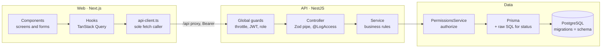

# Vetify Refactor Plan: SOLID, DRY, KISS, YAGNI

Last updated: October 20, 2026.

## Summary

Vetify needs a targeted refactor, not a rewrite: 16 findings fixed in 6 phases remove most
duplication and split the two oversized files, with no change to API behavior or security
controls.

The base is already sound. Controllers are thin, `PermissionsService.authorize` is the single
door to pet data, Zod schemas in `@vetify/types` are the one contract for validation, OpenAPI and
the web client, and row-to-DTO mappers are separate. The problems are local:

- **Duplication (DRY):** the same idempotency boilerplate is written 8 times in controllers and
  8 times in services; the user-row lock and the session-active check are each written 2–3
  times, with an inconsistent expiry comparison.
- **Oversized units (SRP):** `records.service.ts` (570 lines) mixes record reads,
  vaccination-status SQL, alerts and 7 write commands; `api-client.ts` (417 lines) repeats 7
  near-identical record methods.
- **Fragile coupling:** the web translates API errors by matching English message text, so
  rewording an API message silently breaks the Spanish UI.
- **Speculative code (YAGNI):** an empty AI module, a stale Supabase schema that claims to be the
  source of truth, and two parallel sets of architecture docs.

**What stays fixed:** every route, status code, error code, response shape, authorization rule,
access-log entry, idempotency guarantee and session invariant in
[SECURITY_HANDOFF.md](SECURITY_HANDOFF.md). Each phase ships alone, behind the existing test
suites.

## Current architecture

Vetify is a pnpm/Turborepo monorepo: a Next.js PWA (`apps/web`), a NestJS API (`apps/api`,
Prisma on PostgreSQL) and `@vetify/types`, the Zod schemas both apps share. About 12,000 lines of
TypeScript.

A request leaves the only `fetch` caller, passes three global guards, and reaches a thin
controller. The service then calls `PermissionsService.authorize` before any pet query. The
global `AccessLogInterceptor` logs every `:petId` route and `HttpExceptionFilter` shapes every
error. The refactor keeps this path; it only moves code within each box.

## Findings by principle

Duplication is the biggest cost: 9 of the 16 findings involve DRY, and fixing them also shrinks
the two oversized files. Severity reflects maintenance and correctness risk, not line count.

| #   | Principle            | Finding                                                                                                                                                     | Evidence                                                                                    | Severity | Phase |
| --- | -------------------- | ----------------------------------------------------------------------------------------------------------------------------------------------------------- | ------------------------------------------------------------------------------------------- | -------- | ----- |
| F1  | DRY, correctness     | Session-active check written 3 times with different expiry rules: `expiresAt < now` in the JWT strategy, `expiresAt <= now` in idempotency                  | `auth/jwt.strategy.ts`, `common/idempotency.ts`, `auth/auth.service.ts` (`validateRefresh`) | High     | 1     |
| F2  | DRY                  | `SELECT … FOR UPDATE` user-row lock duplicated; the two copies must stay identical or session revocation races reopen                                       | `auth/auth.service.ts` (`lockUser`), `common/idempotency.ts`                                | High     | 1     |
| F3  | DRY                  | `@ApiHeader('Idempotency-Key', …)` with the same description pasted 8 times; `@Headers('idempotency-key')` 8 times                                          | `records/records.controller.ts`, `pets/pets.controller.ts`                                  | Medium   | 2     |
| F4  | DRY, KISS            | Each of 7 record writes repeats the `idempotentWrite(prisma, user, scope, key, data, authorize, write)` call; scope strings are hand-built                  | `records/records.service.ts`                                                                | Medium   | 2     |
| F5  | KISS, ISP            | `idempotentWrite` takes 7 positional parameters and does 7 jobs (key format, lock, session, cleanup, replay, quota, size cap) in one 100-line closure       | `common/idempotency.ts`                                                                     | Medium   | 1     |
| F6  | SRP                  | `RecordsService` owns record reads, two raw-SQL status queries, alerts and 7 writes                                                                         | `records/records.service.ts` (570 lines)                                                    | Medium   | 3     |
| F7  | DRY, SRP             | "List visible pets, cap at 200, log each patient for clinics" written twice                                                                                 | `pets/pets.service.ts` (`list`), `records/records.service.ts` (`alerts`)                    | Medium   | 3     |
| F8  | OCP, coupling        | Web maps errors by English text (`BAD_REQUEST_DETAIL[error.message]`, `issue.message.startsWith('Date must be')`); any API rewording breaks the UI silently | `web/src/lib/errors.ts`, `web/src/lib/forms.ts`                                             | High     | 4     |
| F9  | DRY, OCP             | 7 identical `recordX` methods in the client and 7 matching mutations in the hook; a new entry type touches 4 files                                          | `web/src/lib/api-client.ts`, `web/src/hooks/useRecord.ts`                                   | Medium   | 5     |
| F10 | DRY                  | Query keys bypass `keys.ts`: `['pets', petId, 'access-log']` and `['admin', 'clinics']` written inline                                                      | `hooks/useRecord.ts`, `hooks/usePermissions.ts`, `hooks/useClinic.ts`                       | Low      | 5     |
| F11 | SRP                  | 30-line page-merge logic for "load more" lives inside a hook callback, untestable on its own                                                                | `hooks/useRecord.ts`                                                                        | Low      | 5     |
| F12 | DRY                  | Spanish copy spread over 4 files (`ACTIONS`, `SCOPES`, `speciesLabel`, deworming kinds also typed again in `clinic-actions.tsx`)                            | `permissions-manager.tsx`, `format.ts`, `clinic-actions.tsx`                                | Low      | 5     |
| F13 | KISS                 | `restore` authorizes, then calls `setStatus`, which authorizes again (2 extra queries)                                                                      | `permissions/permissions.service.ts`                                                        | Low      | 3     |
| F14 | DRY                  | List cap `200` defined 3 ways (`MAX_PETS`, `MAX_LIST`, literal) and page size `50` in 3 places                                                              | `records`, `pets`, `admin` services; `api-client.ts`, `useRecord.ts`                        | Low      | 3     |
| F15 | YAGNI                | `AiModule`/`AiService` is empty and `ai.ts` schemas are unused, yet both ship in every build                                                                | `api/src/ai/`, `packages/types/src/ai.ts`                                                   | Low      | 6     |
| F16 | YAGNI, single source | `supabase/schema.sql` (Spanish names, RLS) calls itself the source of truth; Prisma migrations are the real one. Spanish `docs/` duplicates `apps/docs`     | `supabase/schema.sql`, `docs/ARQUITECTURA.md`, `docs/MODELO_DATOS.md`                       | Medium   | 6     |

**Principles with nothing to fix.** LSP: the only hierarchies are
`AppException extends HttpException` and `ApiRequestError extends Error`; both are
substitutable. DIP: services depend on the concrete `PrismaService` through Nest DI, and tests
run against a real database. Adding repository interfaces would create single-implementation
abstractions (see [Out of scope](#out-of-scope-what-not-to-build)).

**Found in passing, not part of this refactor:** `updatePetSchema` accepts no `null`, so an owner
can never clear a birth date, breed or microchip once set. Fixing it changes the public contract;
track it separately.

## Target architecture

The layers stay the same; ownership gets sharper. Each rule below has exactly one file that owns
it, so a change to that rule touches one place.

| Rule or concern                                | Owner after refactor                                                    | Today                      | Phase |
| ---------------------------------------------- | ----------------------------------------------------------------------- | -------------------------- | ----- |
| Lock a user row; decide if a session is active | `api/src/auth/sessions.ts` (new)                                        | 3 files                    | 1     |
| Replay, quota and size cap for keyed writes    | `api/src/common/idempotency.ts`, small named steps                      | Same file, one closure     | 1     |
| Idempotency-Key header docs and parsing        | `api/src/common/decorators/idempotent-write.decorator.ts` (new)         | 8 copies                   | 2     |
| Record history paging and the 7 writes         | `api/src/records/records.service.ts`                                    | Mixed with status          | 3     |
| Vaccination status, alerts, latest-dose SQL    | `api/src/records/vaccination-status.service.ts` (new)                   | `records.service.ts`       | 3     |
| "Visible pets, capped, clinic listing logged"  | `PetsService.listVisible`                                               | 2 copies                   | 3     |
| List caps and page sizes                       | `api/src/common/limits.ts` (new)                                        | 5 places                   | 3     |
| Machine-readable error reasons                 | `apiErrorSchema.reason` in `@vetify/types`                              | English message text       | 4     |
| Record entry types (path + schema)             | One table in `api-client.ts`, typed by `CreateEntry` in `@vetify/types` | 7 methods + 7 mutations    | 5     |
| Merging a "load more" page                     | `web/src/lib/record-pages.ts` (new)                                     | Inline in a hook           | 5     |
| All es-CR display copy                         | `web/src/lib/labels.ts` (new) + `errors.ts`                             | 4 files                    | 5     |
| Data model                                     | Prisma schema and migrations                                            | Also `supabase/schema.sql` | 6     |

**Conventions to keep after the refactor:**

- Controllers hold HTTP and OpenAPI only; every rule lives in a service.
- A service method that touches pet data calls `authorize` first, or receives the `Access` it
  returned.
- Row-to-DTO conversion lives in `*.mapper.ts`, one per module.
- Shared contracts live in `@vetify/types`; neither app redefines a shape the package exports.
- A helper is extracted on the second real use, not the first.

## Phased refactor plan

Six phases, one pull request each, ordered by risk: the security-critical consolidation goes
first while the test suites are fresh, and deletions go last. Phases 4 and 5 touch only the web
app and can run in parallel with 2 and 3.

### Phase 1 — One home for session and lock primitives (F1, F2, F5)

1. Create `apps/api/src/auth/sessions.ts` with two functions and nothing else:
   - `lockUser(tx, userId)` — the single `SELECT id FROM users WHERE id = $1::uuid FOR UPDATE`.
   - `isSessionActive(session, userId, now)` —
     `!!session && session.userId === userId && !session.revokedAt && session.expiresAt > now`.
2. Use them from `AuthService`, `JwtStrategy` and `idempotentWrite`. Pick `expiresAt > now`
   everywhere and add a boundary test at exactly `expiresAt`.
3. Rewrite `idempotentWrite` to take one options object:
   `idempotentWrite(prisma, { user, scope, key, payload, authorize, write })`. Inside, split the
   closure into named steps in the same file (`assertKeyFormat`, `assertSessionActive`,
   `pruneExpired`, `findReplay`, `assertQuota`, `storeResult`). No class, no new module.
4. Merge the two consecutive `if (keyHash)` blocks into one.

**Done when:** `rg "FOR UPDATE" apps/api/src` returns 1 hit; `security.integration.spec.ts` and
`security.e2e.mjs` pass unchanged.

### Phase 2 — Declare idempotent writes once (F3, F4)

1. Add `common/decorators/idempotent-write.decorator.ts`:
   - `IdempotentWrite()` = `applyDecorators(ApiHeader({...}), ErrorResponses(409, 429))`, so the
     header text lives in one constant.
   - `IdempotencyKey()` = `createParamDecorator` reading the `idempotency-key` header.
2. Replace the 8 header blocks in `RecordsController` and `PetsController`.
3. In `RecordsService`, add one private helper:
   `private write<T>(user, petId, kind: RecordSection, operation, key, data, fn)`. It builds the
   scope in today's format (`recordConsultation:<petId>`, petId lowercased) and calls
   `idempotentWrite`. Each of the 7 public methods keeps only its own validation and `create`
   call.

**Scope-string caution:** stored rows use scopes like `recordConsultation:<petId>`. Either keep
that exact format or accept that in-flight retries during deploy get a fresh write. Keep the
format; it costs nothing.

**Done when:** `records.controller.ts` drops roughly 80 lines; generated `openapi.json` is
byte-identical (diff it).

### Phase 3 — Split RecordsService by reason to change (F6, F7, F13, F14)

1. Move `computeStatuses`, `vaccinationStatus` and `alerts` into
   `records/vaccination-status.service.ts`. Hoist the repeated `Prisma.join(ids.map(...))` into
   one `petIdList` constant.
2. Leave `RecordsService` with `get` (paged record) and the 7 writes. `AlertsController` and the
   `vaccination-status` route point at the new service.
3. Add `PetsService.listVisible(user, action)`: find visible pets, cap, and write the clinic
   access-log entry. `PetsService.list` and the alerts code both call it, so the "clinic listing
   is logged" rule lives once.
4. Have `restore` call a private `setStatusUnchecked` after its own `authorize`, removing the
   second authorization round trip.
5. Move list caps into `common/limits.ts`: `MAX_LIST = 200`, `DEFAULT_PAGE = 50`. Move
   `toPermission` into `permissions/permission.mapper.ts` to match the other mappers.

**Done when:** no API file exceeds 350 lines; `permissions.service.spec.ts` and
`vaccination.spec.ts` pass; access-log rows for a clinic listing are unchanged.

### Phase 4 — Stable error reasons instead of English text (F8)

1. Add an optional `reason` to `apiErrorSchema` in `@vetify/types` with a closed enum:
   `EXPIRY_BEFORE_APPLIED`, `NEXT_DOSE_BEFORE_APPLIED`, `CONSULTATION_NOT_IN_PET`,
   `END_BEFORE_START`. It is additive, so existing clients keep working.
2. Extend `badRequest(message, reason?)` and pass the reason at the 4 throw sites.
3. In the shared Zod date helpers, raise custom issues with
   `params: { reason: 'DATE_OUT_OF_RANGE' | 'DATE_IN_FUTURE' }`.
4. Key the web maps on `reason`, not on `message`. Delete `BAD_REQUEST_DETAIL` and the
   `startsWith` checks.

**Done when:** `rg "message.startsWith|message.includes|BAD_REQUEST_DETAIL" apps/web` is empty
and changing any English API message leaves the UI text unchanged.

### Phase 5 — Web client and hooks (F9–F12)

1. In `api-client.ts`, replace the 7 `recordX` methods with one typed method driven by a table:
   - `const RECORD_PATHS = { consultations: 'consultations', vaccinations: 'vaccinations', … } satisfies Record<WritableSection, string>`
   - `recordEntry<S extends WritableSection>(petId, section: S, data: CreateEntry[S], key)`

   The `CreateEntry` map type lives in `@vetify/types` next to the schemas.

2. `useRecordEntries` builds its mutations from the same table, so a new entry type is one table
   row plus one schema.
3. Add `keys.petAccessLog(petId)` and `keys.adminClinicsAll`, and replace the inline arrays.
4. Extract `mergeRecordPage(current, page, section, cursor)` into `lib/record-pages.ts` with a
   unit test for the stale-cursor guard.
5. Gather display copy into `lib/labels.ts` (`accessActionLabel`, `scopeLabel`, `speciesLabel`,
   `dewormingKindLabel`), and build the deworming `<Select>` options from it.

**Done when:** `api-client.ts` is under 300 lines; `api-client.spec.ts` passes; a manual pass
records each of the 7 entry types once in the browser.

### Phase 6 — Remove what nothing uses (F15, F16)

1. Delete `apps/api/src/ai/`, its import in `app.module.ts`, and `packages/types/src/ai.ts`. Keep
   the Prisma `Anomaly` model and table; dropping them needs its own migration.
2. Delete `supabase/schema.sql`, or move it to `docs/archive/` with a header saying Prisma
   migrations are authoritative.
3. Pick `apps/docs` as the one technical reference. Replace `docs/ARQUITECTURA.md` and
   `docs/MODELO_DATOS.md` with links, keeping course deliverables (`AVANCE_2.md`, user stories,
   requirements) where they are.

**Done when:** `pnpm build` and `pnpm typecheck` pass; no file references `supabase/` or
`AiModule`.

## Guardrails

Every phase must leave security behavior unchanged; a refactor PR that needs an existing test
changed is not a refactor and gets split. The one intended change is Phase 1's expiry boundary: a
session at exactly `expiresAt` becomes rejected everywhere, covered by a new test.

**Invariants that must hold after each phase** (from [SECURITY_HANDOFF.md](SECURITY_HANDOFF.md)):

- Every read or write of pet data goes through `PermissionsService.authorize`. Owners get 404 for
  a pet that is not theirs.
- `clinicId` and `veterinarianId` come from the permission and the token, never from the request
  body.
- Every session writer, and every keyed write, takes the user-row lock before touching session
  rows.
- Idempotent writes reauthorize on replay, reject a reused key with different data (409), and
  stay within 1,000 results per user and 64 KB per result.
- Every `:petId` route still writes an access-log entry with the same action name.
- Refresh rotation and replay revocation commit before the 401.

**Checks per PR:**

- [ ] `pnpm lint`, `pnpm typecheck` and `pnpm test` pass at the root
- [ ] `pnpm --filter @vetify/api test:e2e` passes against a disposable database
- [ ] `apps/docs/static/openapi.json` regenerated and diffed: no change except Phase 4's additive
      `reason` field
- [ ] No test assertion edited; new tests only added
- [ ] Handoff doc updated if a control's file location moved (Phase 1 and 3 move code the handoff
      cites)

Use the `codex/write-idempotency` branch's current tests as the baseline: run them once before
Phase 1 and record the pass count in the PR.

## Out of scope: what not to build

These are deliberately **not** part of the refactor. They look like "clean architecture" but
would add surface without a second use. Revisit one only when the trigger in the right column
happens.

| Tempting change                                                       | Why not now                                                                                                                | Revisit when                                   |
| --------------------------------------------------------------------- | -------------------------------------------------------------------------------------------------------------------------- | ---------------------------------------------- |
| Repository interfaces over Prisma (`IPetRepository`)                  | One implementation; integration tests already use a real database                                                          | A second datastore exists                      |
| A generic `BaseRecordService<T>` or record-type registry on the API   | The 7 writes differ in validation and side effects (reminders, consultation check); a helper method covers the shared part | More than ~12 entry types                      |
| CQRS, domain events or a mediator                                     | One process, synchronous writes, no consumers                                                                              | A second service needs record events           |
| An i18n library                                                       | One locale (es-CR); a typed `labels.ts` is enough                                                                          | A second language is planned                   |
| Unifying the two pagination styles (id cursor vs `occurredAt` + `id`) | Each fits its ordering; both are tested                                                                                    | A third paginated list appears                 |
| Moving Throttler to Redis                                             | Single instance today, as documented in `app.module.ts`                                                                    | A second API instance                          |
| An offline write queue in the PWA                                     | Explicitly excluded by the idempotency design                                                                              | A product decision to support offline writes   |
| Rewriting raw SQL status queries in Prisma                            | The raw SQL exists for index use; Prisma cannot express the lateral joins                                                  | Never as a refactor; only with a measured plan |
